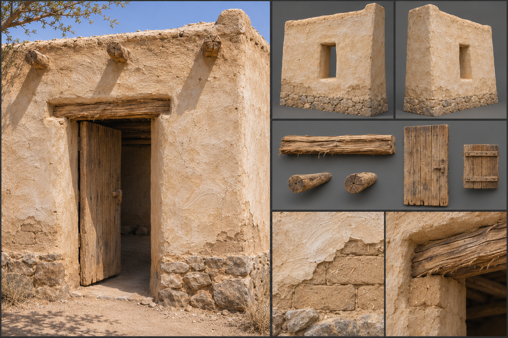
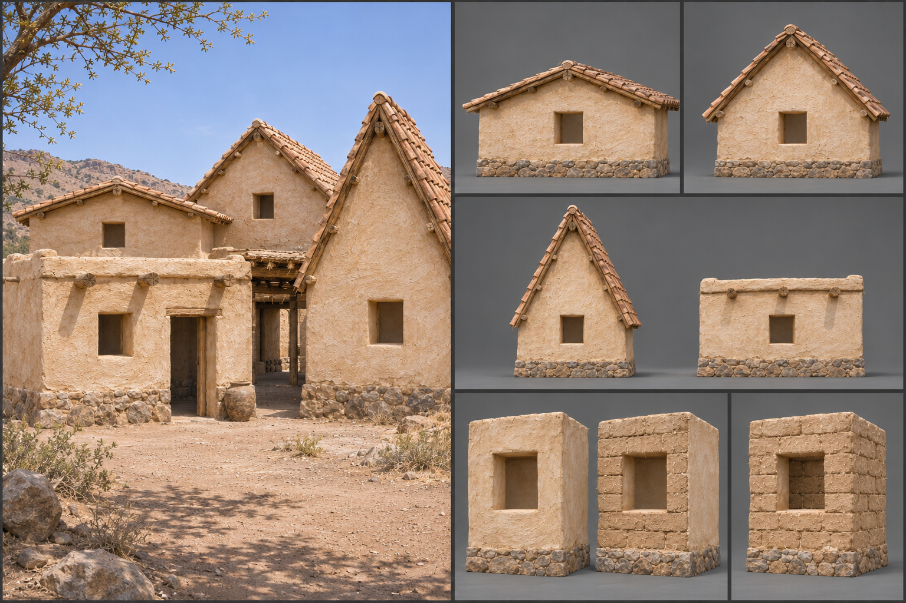

# Clay and Adobe

Clay and adobe is earth building in its plainest form: mud mixed with straw or chopped reed, pressed into wooden moulds, turned out as bricks and dried in the sun until they ring. It sits in the material family between the timber tiers and the fired and cut stone above it, and it is the answer of dry country to a shortage of trees. Humans raise it across the [Scorching Desert](../../Biomes/Scorching-desert.md) and the drier reaches of the [Plains](../../Biomes/Plains.md), and a frontier builder with no forest near will use it anywhere there is clay to dig. Its gameplay properties are set out under [Materials](../../Building-system.md#materials); this brief fixes only how it looks.

## Look at Eye Level

The wall reads as one soft mass before it reads as bricks. Each brick is hand-moulded to about 0,40 metres long, 0,20 metres wide, and 0,10 metres thick, and no two are quite the same: corners are slightly rounded, faces are slightly dished, and the long edges wander by a centimetre or two. The bricks are laid in a running bond with a mud mortar of the same earth, so joints are thick, 0,02 to 0,03 metres, and sit nearly flush with the brick faces. Finished walls are rarely left bare. A coat of clay render, thumb-smoothed with visible hand sweeps, buries the bricks, and over it goes a limewash of chalk white or pale ochre.

Colour follows the ground the clay came from: sun-bleached sand and buff in the desert, warm tan and straw-yellow on the plains, a redder terracotta where the earth is iron-rich. Where render has worn away, the straw shows in the brick as pale flecks and hair-thin lines. Corners are rounded by hand and by weather, window and door reveals are deep and splayed, and walls are thick, a full 0,40 metres at the least, so the openings read as cut into a mass. Surfaces are matt and powdery, with no sheen, and small cracks run in the render where it dried too fast.

## Construction and Joints

The kit is three kinds of piece. The wall piece is only the earth wall: a 3-metre module of brick built straight with a slight batter, its face leaning in a few centimetres toward the top, rendered over so the bond disappears. Its opening, where it has one, is a narrow clean reveal, deep and splayed, and reads complete with nothing fitted. Corners are bonded by alternating courses before the render goes on. A plinth variant of the wall piece, a low course of fieldstone or cobble 0,30 to 0,50 metres tall, keeps rising damp from the bricks; it is the only hard material in the kit and reads as a different, rougher course.

The frame members are separate timber. The lintel across an opening is a whole split palm-trunk or squared beam 0,15 metres deep that snaps onto the wall face, bears on the brick at both ends, and is left exposed above the opening. Floor beams and the short projecting roof-beam ends are frame members too, their ends showing as a row of round or square dark spots under the eaves where they pass into pockets in the brick. The fittings are the doors, the small shutters, the waterspout stones and the cloth awnings of the desert, each placed on the wall as its own hosted piece; see [Fittings](../../Building-system.md#fittings). Together they make the characteristic adobe house, a rendered wall with a bare timber lintel and a door set deep in its thickness, a combination a builder assembles as a [pattern](../../Building-system.md#patterns).

Floors are rammed earth, finished with a smooth clay slip. Roofs come in 27-, 45-, and 60-degree pitches and flat, and flat is the characteristic one: a layer of beams, then reed matting, then packed clay, with a low parapet. The steeper pitches are carried on timber trusses under clay tile or thatch. Where this wall meets a wall of another material, the edge is a plain hard edge, and a builder who wants it hidden sets a post, pillar, beam, or trim over it.

## Wear, Weathering, and Damage

The base material is soft, and its wear is part of its look from the first day: render flakes at the foot of the wall, sharp edges round off, and the plinth line carries a darker stain where splash reaches. Climate does the rest. In the desert, wind-borne sand scours the windward face to bare brick and bleaches everything towards the same pale tone; in the rain of the plains, water runs down from lintels and parapets in long dark streaks, the render slumps at the base, and grass takes root in the eaves. A building that is not recoated every few seasons loses its white and shows the brown of the brick beneath.

Damage reads as loss of mass. A struck wall first cracks in long diagonals from the corners of openings, then the render falls away in plates and the bricks beneath crumble at their edges. At the worst the wall slumps into a heap of dry earth and loose bricks, with the timber lintels and beam ends standing out of it. How the stages trigger is set out under [Damage and Siege](../../Building-system.md#damage-and-siege).

## Variants

Plains work is rendered in warm ochre and left unpainted, with thatch eaves in place of flat roofs. Desert work is limewashed bright white or sand-pink, with flat roofs, small deep windows, and rooftop awnings of stretched cloth. A trader's house may carry a band of pressed geometric ornament in the render beneath the parapet, or a lintel tinted in a single mineral colour. Finishes change only the surface of a piece and never add a part: for this material they are bare brick, thumb-smoothed clay render, limewash, ochre or mineral tint, and pressed ornament in the render. A wall type offers its face combinations as part of these finishes, each face showing the material or a lining that suits it, chosen and changed in place without adding a part or changing strength; for adobe they are rendered clay on both faces, bare brick outside with a smooth clay render inside, and bare brick on both faces. Painted panels and applied mouldings are trim fittings, placed as pieces of their own. The rules are described under [Decoration and Detail](../../Building-system.md#decoration-and-detail).

## Reference Set

A reference set for this material comprises an assembled wall with a doorway, a timber lintel, a door and a flat roof edge seen at first-person eye height; the bare wall piece and a corner piece, front and rear, with nothing fitted and the opening left as a clean reveal; the frame members and fittings each on their own, namely the lintel and projecting beam ends, the door and the shutter; a close view of the render surface, a close view of an exposed brick end and the plinth course, a close view of a lintel bearing, and a worn example with flaked render and slumping at the foot. Each is shown under neutral light and under in-game light, midday desert glare and a low overcast. The set shows the wall's face combinations and the roof at each pitch. The set avoids clean game-ready uniformity: no ruler-straight edges, no identical bricks, no pristine white, and no fitting or frame member merged into the wall piece. It also avoids the borrowed look of a modular survival-game adobe kit with a repeated tile texture and uniform arches.

## Continue Reading

See also: [Building materials](../Building-materials.md), [Art Direction](../../Art-direction.md), [Surface authoring](../Surface-authoring.md), [Fired brick](Fired-brick.md), [Fieldstone](Fieldstone.md).

## Draft

<!-- Raw notes land here. Add new content in any form; an AI assistant reworks it into the body above as finished prose, then clears what it has integrated. -->
