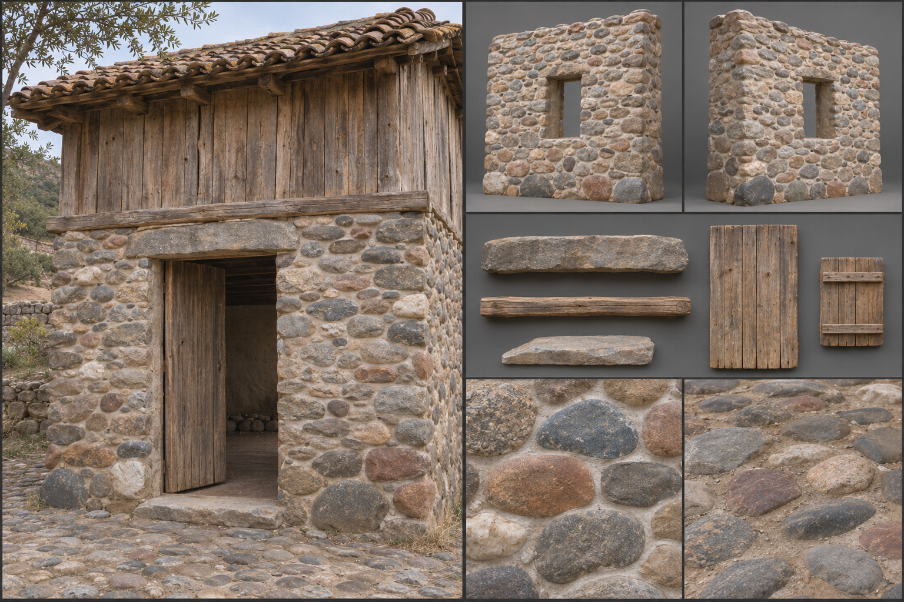
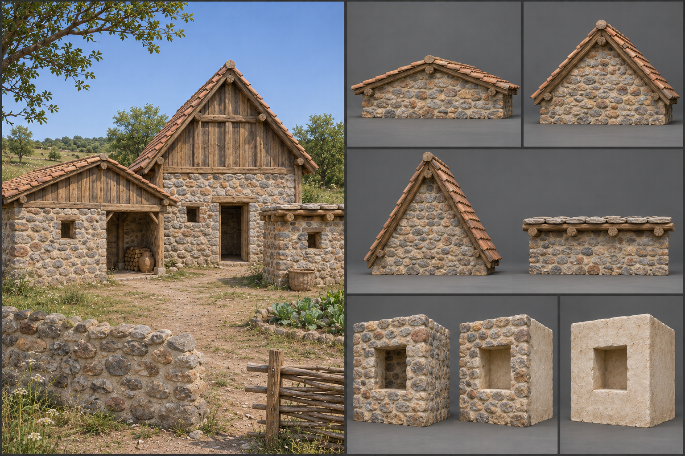

# Cobblestone

Cobblestone is rounded river and field stone, roughly fist- to head-sized, laid in coursed rows in lime mortar. It is the first mortared stone in the material family, a step between dry-laid [fieldstone](Fieldstone.md) and cut [dressed stone](Dressed-stone.md): the stones are still gathered rather than shaped, but the builder now sorts them by size, lays them in level courses, and binds them with lime. Builders use it for foundations, lower walls, wells, and paving, anywhere a strong, cheap, rain-proof base is wanted. Its gameplay properties are set out under [Materials](../../Building-system.md#materials); this brief fixes only how it looks.

## Look at Eye Level

The wall reads as rows of rounded stones, each about 0,10 to 0,25 metres across, set in a grey-white mortar bed. The stones are water-worn: smooth, egg-shaped or flattened, with no sharp arrises, and they are sorted so that each course holds stones of a similar height, with the largest at the base and the smallest at the top. Colour is the mix of the river gravel they came from, a speckled blend of grey, brown, rust, cream, and blue-black, with a few white quartz stones. Lime mortar fills the joints to 0,02 to 0,04 metres, struck flush or slightly recessed so each stone stands a little proud, wet-dark where the rain has caught it.

The courses run level for a metre or so and then step slightly where the stone size changes, which gives the wall a faint wavering line. Wall thickness is 0,40 to 0,60 metres, with the face plumb or slightly battered. Corners are the weak point visually: with no square stones to turn on, the builder uses the biggest cobbles and interlocks them, so corners read as rounded or slightly bulging, sometimes strengthened with a quoin of dressed blocks.

## Construction and Joints

The kit is separate pieces. The wall piece is only the cobble wall: laid on a foundation trench of larger cobbles set dry, then built up in coursed rows, each course levelled with a line. On the 3-metre module the wall is bonded through its thickness with long cobbles laid across, and a flat stone bed is set every metre or so to level the work. Where it has an opening, the opening is a bare reveal that reads complete with nothing fitted, and a rough arch of wedged cobbles may be coursed into the wall piece to carry a heavier opening. The foundation variant is the same wall piece as a footing.

The frame members are the flat stone or timber lintels laid across an opening, snapped onto the wall face, and the timber sill plate that tops a foundation. The fittings are the slabs of flat stone that serve as sills, with a slight outward slope, and the doors and shutters placed in the openings; see [Fittings](../../Building-system.md#fittings). Together they make a mortared lower storey, a cobble wall with a slab-lintelled door, a combination a builder assembles as a [pattern](../../Building-system.md#patterns).

As a foundation, cobble work carries a timber or brick upper wall on its top course, the join marked by a slight set-back and otherwise a plain hard edge, which a builder can hide under a timber sill plate, a post, or trim. Roofs over cobble walls come in 27-, 45-, and 60-degree pitches and flat; a 45-degree pitch under tile or thatch reads most characteristic. Paving is laid as a bed of sand with cobbles set on edge in tight rows, their rounded tops forming a bumpy surface, with lime or sand filling the gaps; roads in settlements follow the same pattern, with a central gutter where the stones are laid lower. Floors inside are flagged over a cobble bed.

## Wear, Weathering, and Damage

Base wear belongs to the lime: the mortar is its softest part, and it erodes first, leaving stones standing proud of a recessed joint and eventually loosening. Climate sets the colour. In the [Plains](../../Biomes/Plains.md) the wall greys and lichen speckles the stones, in the [Coast](../../Biomes/Coast.md) salt crusts white on the weather face and the mortar powders faster, and in the [Swamp](../../Biomes/Swamp.md) the base courses are dark green and slick. Paving polishes at the wheel tracks and loses stones at the edges.

Damage reads as the mortar failing. Joints crack and crumble, single cobbles drop out and leave round holes, and the face then bellies outward in a rounded bulge as the rubble core spills. At its worst the wall collapses into a heap of loose round stones and white mortar lumps. See [Damage and Siege](../../Building-system.md#damage-and-siege) for how the stages trigger.

## Variants

River-country cobble is rounded and multicoloured, with a smoother finish. Upland and field cobble is more angular and one colour, from granite or limestone. Coastal beach cobble is flat, oval, and grey, often laid in herringbone courses. A prosperous town may point the joints with a darker, struck-and-raised bead, and a well-kept road may carry a border of larger dressed kerbstones. Finishes change only the surface of a piece and never add a part: for this material they are the mortar finish, whether struck flush, recessed or raised in a bead, the stone mix and the bed pattern. A wall type offers its face combinations as part of these finishes, each face showing the material or a lining that suits it, chosen and changed in place without adding a part or changing strength; for cobble they are cobble on both faces, cobble outside with lime plaster inside, and plastered on both faces. Carved or painted dressings are trim fittings, placed as pieces of their own. The rules are described under [Decoration and Detail](../../Building-system.md#decoration-and-detail).

## Reference Set

A reference set for this material comprises an assembled foundation and lower wall carrying a timber upper storey at first-person eye height, the bare wall piece and a corner piece, front and rear, with nothing fitted and the opening left as a clean reveal, the lintel frame member and the sill and door fittings each on their own, a close view of the cobbles and mortar, a close view of a paved area, a close view of a joint where the mortar has failed, and a worn example with fallen cobbles. Each is shown under neutral and in-game light, dry and rain-wet. The set shows the wall's face combinations and the roof at each pitch. The set avoids uniform pebble-dash textures, perfectly circular stones, a repeated tile of the same twelve cobbles, and the borrowed look of generic cobblestone blocks from other games. No fitting or frame member is merged into the wall piece.

## Continue Reading

See also: [Building materials](../Building-materials.md), [Art Direction](../../Art-direction.md), [Surface authoring](../Surface-authoring.md), [Fieldstone](Fieldstone.md), [Dressed stone](Dressed-stone.md).

## Draft

<!-- Raw notes land here. Add new content in any form; an AI assistant reworks it into the body above as finished prose, then clears what it has integrated. -->
