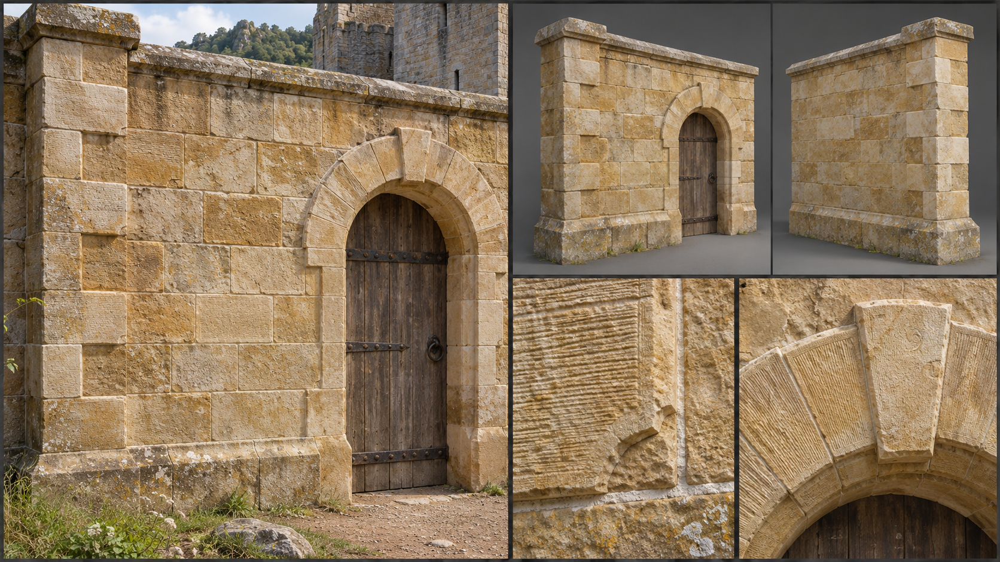

# Dressed Stone

Dressed stone is quarried rock cut to shape: squared blocks with worked faces, laid in regular courses with fine joints. These are the stone bricks of a keep, and the point in the material family where building stops following the shape of the stone and starts imposing a shape on it. A mason's yard produces it, and human towns, elven bone-pale halls, and the outer works of dwarven holds all use it, each in their own proportions. Its gameplay properties are set out under [Materials](../../Building-system.md#materials); this brief fixes only how it looks.

## Look at Eye Level

The wall is built of squared blocks in ashlar, each about 0,60 metres long, 0,30 metres high, and 0,30 to 0,40 metres deep, with the face dimensions varying by a few centimetres from block to block. Faces carry the marks of the mason's tools: a pitched or boasted face is chiselled in fine parallel lines, a punched face shows dots, and a drafted margin of smooth chisel work often frames a rougher centre. Edges are crisp but never razor-sharp, with small chips at arrises where blocks were handled.

Colour is the quarry's: warm honey and cream limestone, pale grey granite, buff and red sandstone, near-black slate. Within a single wall there is variation from block to block, because the quarry bed changes, with the odd darker block, ochre veining or fossil shell showing in limestone. Joints are fine, 0,005 to 0,01 metres, in pale lime mortar, laid in regular horizontal courses with each block overlapping the joint beneath by half (running bond). Courses can taper, with deeper blocks low and shallower blocks high, which gives the wall its sense of rising mass.

## Construction and Joints

The kit is separate pieces. The wall piece is only the ashlar wall: on the 3-metre module a panel of about five courses of 0,60 metres, built with the corners carried up first as quoins, long and short blocks alternately, so that corners of tower and keep show the full squared quoin pattern. A plinth variant of the wall piece is the projecting base course. Where the wall has an opening, a semicircular or pointed arch of wedge-shaped voussoirs with a keystone and a chamfered or moulded reveal is coursed into the wall piece as part of how the opening is built, and the opening reads complete with nothing fitted.

The frame members are the single stone or timber lintel laid across an opening where no arch is built, snapped onto the wall face, and the corbel stones and floor beams that carry upper floors. The fittings are the sills, single slabs with a drip groove, the window frames, glass, shutters and iron bars, the doors and gates, and the projecting string course and coping that finish a wall top; see [Fittings](../../Building-system.md#fittings). Together they make the keep: coursed walls with an arched doorway, a barred slit window and a coped parapet, a combination a builder assembles as a [pattern](../../Building-system.md#patterns).

Wall tops are finished with a coped parapet or a battlement with merlons cut in stone. Floors are flagged in square stone slabs or are timber on stone corbels set into the wall. Stairs are built in stone, each tread a single block turned into the wall. Where timber meets stone, as in a roof plate or a floor beam, the timber ends sit in squared sockets or on corbel stones, with a lead or lime bed beneath.

## Wear, Weathering, and Damage

Base wear is edge-and-face wear: sharp corners round slowly, tooling marks fade at doorways and steps where hands and feet pass, and the lime in the joints recedes a few millimetres. Climate stains the surface. Lichens colonise north faces in the [Forest](../../Biomes/Forest.md), pale orange and grey; rain leaves dark runs below sills; in the [Coast](../../Biomes/Coast.md) salt flakes the face; in the [Mountain Range](../../Biomes/Mountain-range.md) frost cracks blocks along their bedding; and soot blackens the stone above hearths and cressets. Limestone dissolves in pitted hollows, while granite stays crisp.

Damage reads as cracks and chips. First arrises spall and corners lose their edge, then cracks run along joints and diagonally through blocks, then individual blocks shift or fall out, leaving square holes in the coursing. At the end the wall is a toothed ruin with courses broken off at uneven heights and cut blocks lying in the rubble. See [Damage and Siege](../../Building-system.md#damage-and-siege) for how the stages trigger.

## Variants

Human work is tall, plain, and buttressed, in grey or honey stone. Elven stone is bone-pale limestone with fine joints, soft rounded edges, and carved leaf mouldings where it meets living wood. Dwarven outer works are massive and dark, with large blocks and a battered base. Finishes change only the surface of a piece and never add a part: for this material they are the tooled face (pitched, boasted, punched or drafted), a chamfered or rounded arris, and the quarry's stone colour. String courses, carved corbels, leaf mouldings and painted panels are trim fittings, placed as pieces of their own. The rules are described under [Decoration and Detail](../../Building-system.md#decoration-and-detail).

## Reference Set

<!-- REVIEW(art-reference): Regenerate in the six-panel layout of the building-material-references recipes: a bare ashlar wall piece with its coursed arch and no door, and the lintel, sill, window frame, shutters, bars, door, and coping as separate parts. Also: The plate is 1672 pixels wide against the set's 1536 by 1024, and a few block faces carry faint scribble marks that read as writing; keep only tool marks. Otherwise it matches the brief. -->

A reference set for this material comprises an assembled keep wall with an arched doorway at first-person eye height, the bare wall piece and a corner piece with quoins, front and rear, with nothing fitted and the opening left as a clean reveal, the lintel frame member and the sill, window frame, shutter, door and string course fittings each on their own, a close view of the tooled face, a close view of a joint, a close view of an arch with voussoirs, and a worn example with spalled arrises and a lichen-streaked face. Each is shown under neutral and in-game light. The set avoids identical blocks tiled perfectly, hairline-fine uniform joints, glossy clean surfaces, and the borrowed look of stone-brick blocks from other survival games. No fitting or frame member is merged into the wall piece.

## Continue Reading

See also: [Building materials](../Building-materials.md), [Art Direction](../../Art-direction.md), [Surface authoring](../Surface-authoring.md), [Fitted masonry](Fitted-masonry.md), [Reinforced stone](Reinforced-stone.md).

## Draft

<!-- Raw notes land here. Add new content in any form; an AI assistant reworks it into the body above as finished prose, then clears what it has integrated. -->
