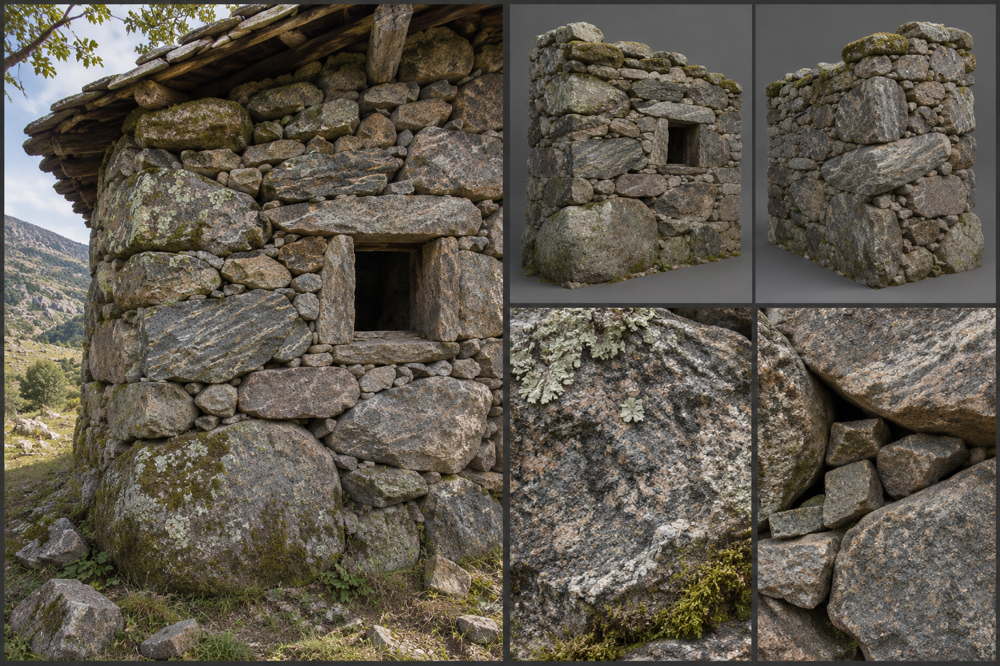

# Fieldstone

Fieldstone is stone as the land gives it: boulders and slabs gathered from fields, hillsides, and stream beds and built up without cutting. It is the first stone in the material family, a rough step beyond timber and clay and the humble predecessor of cobble and cut work. Anyone with a strong back and a pack beast can build with it, and it appears in frontier cabins, field walls, animal pens, and the footings of better buildings. Its gameplay properties are set out under [Materials](../../Building-system.md#materials); this brief fixes only how it looks.

## Look at Eye Level

A fieldstone wall is a puzzle of unequal pieces. Stones run from fist-sized fillers to slabs a metre across, and their faces are whatever the weather left them: rounded, blocky, split, or lumpy. The wall's colour is the local geology, so grey granite and gneiss in the [Mountain Range](../../Biomes/Mountain-range.md) foothills, brown and ochre sandstone in the dry country, pale limestone on the chalk downs, dark basalt where the land is volcanic. Lichen and moss are on the stones before they are built in, and the wall keeps them.

Dry-laid work has no mortar at all, only tight placement and small wedging stones pinned into the gaps, so the joints read as dark shadowed voids of 0,01 to 0,05 metres. Mud-mortared work fills those voids with earth, grey-brown and crumbling, with grass sprouting in the upper courses. Walls are thick, 0,50 to 0,80 metres, with a sloping face; the larger stones sit low, the smaller higher, and every few courses a long through-stone crosses the whole thickness to bind the two faces together. Wall tops are uneven, capped with turf or a row of upright stones on edge.

## Construction and Joints

The kit is separate pieces. The wall piece is only the stone wall: on the 3-metre module it is built to a plumb line that is never quite plumb, with corners finished in the biggest stones, laid long-and-short alternately to lock the two faces. There is no clean quoin: corners are rounded or slightly bulbous. Where it has an opening, the opening is narrow and square, a bare reveal with a jamb of upright stones, and it reads complete with nothing fitted; there are no arches. A plinth variant is the footing course of the largest stones.

The frame members are separate. The single flat slab laid across an opening is a lintel, snapped onto the wall face and bearing on the jambs, and the timber wall plate bedded in the top course is a frame member as well. The fittings are the rough sill slab, the timber door set deep in the thickness and hung on a stone-pegged frame, and any shutter; see [Fittings](../../Building-system.md#fittings). Together they make the frontier cabin: a rough wall, a slab lintel and a plank door, a combination a builder assembles as a [pattern](../../Building-system.md#patterns).

Floors are packed earth or flagged with flat stones, and roofs are timber-framed and thatched, turfed, or covered in stone slate. Gables are built up in stepped stones. Chimneys are rough-built, often leaning slightly. Where a fieldstone wall meets a timber structure, the timber ends are set into sockets with small stones wedged around them.

## Wear, Weathering, and Damage

The base stone does not wear in a hurry; its first-day look is already weathered. What changes is the infill: mud mortar leaches out in rain and leaves the wall hollow-looking, and grass, ferns, and small shrubs root in the joints. Frost heaves stones forward in the [Tundra](../../Biomes/Tundra.md) and the mountains, and in the [Swamp](../../Biomes/Swamp.md) the lower courses go slick and black with algae while the plinth sinks into mud. Moss climbs the north and shaded faces first.

Damage shows as displacement. Stones slip out of the face and leave dark holes, a bulge opens in the wall, and as it worsens the face peels from the core and large stones tumble out. The end state is a long mound of rubble with the occasional lintel stone lying across it. See [Damage and Siege](../../Building-system.md#damage-and-siege) for how the stages trigger.

## Variants

Mountain fieldstone is grey and angular and built tall. Upland pasture work is dry-laid and low, in long field walls with a flat cap. Coastal work uses rounded beach boulders and is bound with tarred rope against the wind. Frontier builders chink the wide joints with clay and rub it in by hand, and a prosperous farm may add lime wash around doors and windows. Finishes change only the surface of a piece and never add a part: for this material they are the bare dry-laid face, mud mortar, clay chinking and limewash. Carved or painted surrounds are trim fittings, placed as pieces of their own. The rules are described under [Decoration and Detail](../../Building-system.md#decoration-and-detail).

## Reference Set

<!-- REVIEW(art-reference): Regenerate in the six-panel layout of the building-material-references recipes: the kit piece currently carries its slab lintel and jambs; show a bare fieldstone wall piece with a square reveal, and the slab lintel, sill slab, door, and shutter as separate parts. The material itself matches the brief; keep its look. -->

A reference set for this material comprises an assembled wall with a doorway, lintel and door at first-person eye height; the bare wall piece and a corner piece, front and rear, with nothing fitted and the opening left as a clean reveal; the slab lintel frame member and the fittings each on their own, namely the sill, the door and the shutter; a close view of the stone faces and lichen, a close view of a dry joint with wedging stones, a close view of a through-stone and a jamb, and a worn example with a bulging face and fallen stones. Each is shown under neutral and in-game light. The set avoids uniform rock tiles, clean, evenly sized stones that look like a pavement pattern, and the borrowed look of stacked stone walls in other survival games. No fitting or frame member is merged into the wall piece.

## Continue Reading

See also: [Building materials](../Building-materials.md), [Art Direction](../../Art-direction.md), [Surface authoring](../Surface-authoring.md), [Cobblestone](Cobblestone.md), [Clay and adobe](Clay-and-adobe.md).

## Draft

<!-- Raw notes land here. Add new content in any form; an AI assistant reworks it into the body above as finished prose, then clears what it has integrated. -->
