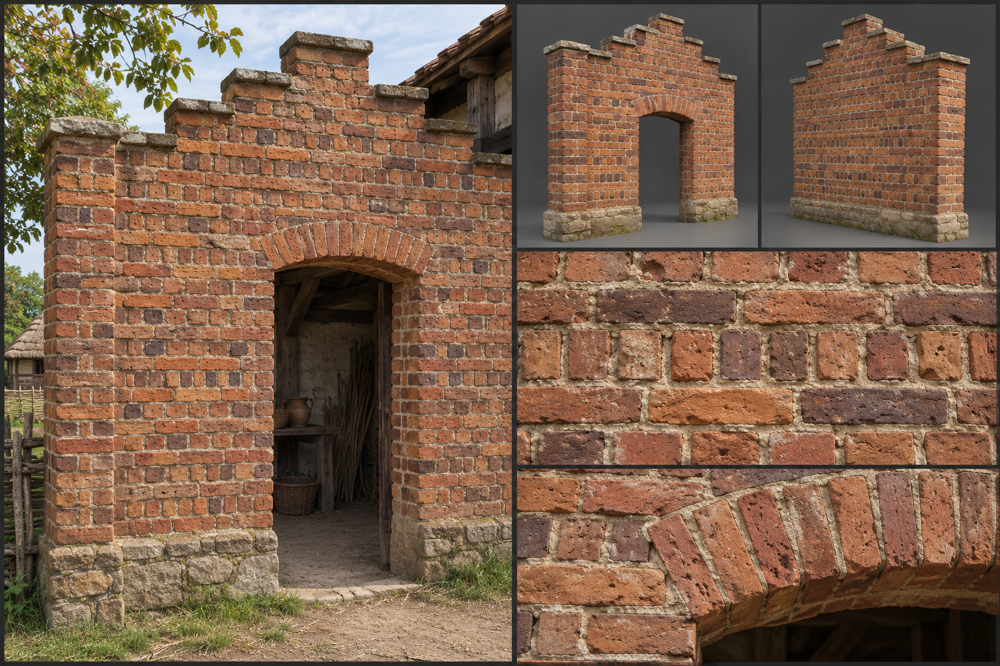

# Fired Brick

Fired brick is clay that has been moulded, dried, and baked in a kiln until it turns hard and permanent. It is the step above sun-dried adobe in the material family: the same earth, but made weatherproof and regular by fire and laid with lime. Human towns build with it wherever clay and fuel are plentiful, and it is the common material of kiln-owning town houses, workshops, and city walls on the plains and in the dry country. Its gameplay properties are set out under [Materials](../../Building-system.md#materials); this brief fixes only how it looks.

## Look at Eye Level

Brick is the most regular building unit in the human palette, and still not regular in the way a modern brick is. A fired brick measures about 0,25 metres long, 0,12 metres wide, and 0,07 metres thick, with slight warps, a few cracked or spalled corners, and visible surface roughness where the mould was sanded or the clay was cut. The colour range runs from pale straw-yellow through salmon and orange-red to deep brick-red and a purple-brown at the hot end of the kiln, and a single wall mixes several of these, because bricks from one firing differ by position in the stack. Clay with more iron fires redder; chalky clay fires cream. Overfired bricks come out dark, glassy, and slightly slumped, and builders set these in decorative patterns on purpose.

The bricks are laid in English bond, alternating courses of long faces (stretchers) and short ends (headers), with lime mortar joints about 0,01 metres wide. The lime mortar is pale grey to cream, slightly recessed or struck flush, and reads as a fine network over the wall. Surfaces are matt and slightly gritty; the faces take on a sooty bloom in town air.

## Construction and Joints

The kit is separate pieces. The wall piece is only the brick wall: a 3-metre module with the English bond carried round every corner, the header courses locking the corner into a staggered toothing, with brick piers at its edges so the bond reads as continuous. A plinth variant of the wall piece is the low stone course the walls stand on. Where the wall has an opening, the opening is a clean reveal set back one half-brick, and a shallow brick arch, a segmental curve of wedge-laid bricks, is coursed into the wall piece as part of how the opening is built, so the opening reads complete with nothing fitted.

The frame members are the squared timber or stone lintel laid across an opening where no arch is built, and the joists and floor beams carried in pockets in the wall. The fittings are the windows' stone or brick sills, projecting a little with a drip at the edge, the window frames, glass and shutters, the doors, and the stone coping or projecting string course that finishes a gable or parapet; see [Fittings](../../Building-system.md#fittings). Together they make the town house: a bonded wall with an arched doorway and a sashed, shuttered window, a combination a builder assembles as a [pattern](../../Building-system.md#patterns).

Floors are brick-on-edge paving or timber on joists. Roofs are timber trusses covered with clay pantiles or slate, with the brick gable stepped. Chimneys are built as stacks of the same brick, with a corbelled top. Where a wall is meant to be defended, the top is finished with a brick parapet and stone caps.

## Wear, Weathering, and Damage

Base wear is shaped by the fire: some bricks spall at the face and show a paler, softer interior, the oldest mortar powders and recesses, and the smoke of town life browns the walls under eaves and chimneys. Climate adds its own record. Rain streaks run down from sills and gutters, soot and lichen take the north faces in the [Plains](../../Biomes/Plains.md), salts bloom white on the lower courses in damp ground, and in the [Swamp](../../Biomes/Swamp.md) the base courses go green and black with algae. Frost lifts individual faces off the surface and leaves a scatter of shed flakes at the foot.

Damage reads in the bond. First the mortar cracks along the joints, then single bricks shift or fall, leaving gaps in the pattern; stronger blows open a stair-stepped breach following the bond lines, and the final collapse is a slope of loose whole bricks and half bricks. See [Damage and Siege](../../Building-system.md#damage-and-siege) for how the stages trigger.

## Variants

Red-brick town work is the commonest, with darker header bricks forming diaper patterns of diamonds in the walls of a wealthy house. Pale yellow brick comes from chalky clay and appears in lowland districts. A guildhall may add bands of stone between brick courses, and a gatehouse may have an overglaze of dark vitrified bricks in a zigzag. Finishes change only the surface of a piece and never add a part: for this material they are the red, yellow and dark-glazed brick, the bond and diaper pattern, a struck or recessed lime joint, and a limewash or sooted face. Stone bands, carved mouldings and painted panels are trim fittings, placed as pieces of their own. The rules are listed under [Decoration and Detail](../../Building-system.md#decoration-and-detail).

## Reference Set

<!-- REVIEW(art-reference): Regenerate in the six-panel layout of the building-material-references recipes: a bare brick wall piece with its coursed arch, and the lintel, sill, window frame, shutters, door, and coping as separate parts. Also: The kit piece has a full semicircular arch; the brief wants a shallow segmental arch. Bricks are too heavily pitted and the mortar is wider than the fine 0,01 metre pale joint. Bond, colour range, stepped gable and plinth are right. -->

A reference set for this material comprises an assembled wall with an arched doorway, a fitted window and a gable at first-person eye height; the bare wall piece and a pier piece, front and rear, with nothing fitted and the openings left as clean reveals; the lintel frame member and the fittings each on their own, namely the sill, the window frame and shutter, the door and the coping; a close view of the brick faces with colour spread, a close view of a mortar joint, a close view of the arch and its bonding, and a worn example with spalled faces and eroded mortar. Each is shown under neutral and in-game light. The set avoids the single-colour, perfectly rectangular brick texture tiled across a wall, the clean modern machine-pressed look, and the borrowed appearance of other survival games' brick kits. No fitting or frame member is merged into the wall piece.

## Continue Reading

See also: [Building materials](../Building-materials.md), [Art Direction](../../Art-direction.md), [Surface authoring](../Surface-authoring.md), [Clay and adobe](Clay-and-adobe.md), [Dressed stone](Dressed-stone.md).

## Draft

<!-- Raw notes land here. Add new content in any form; an AI assistant reworks it into the body above as finished prose, then clears what it has integrated. -->
