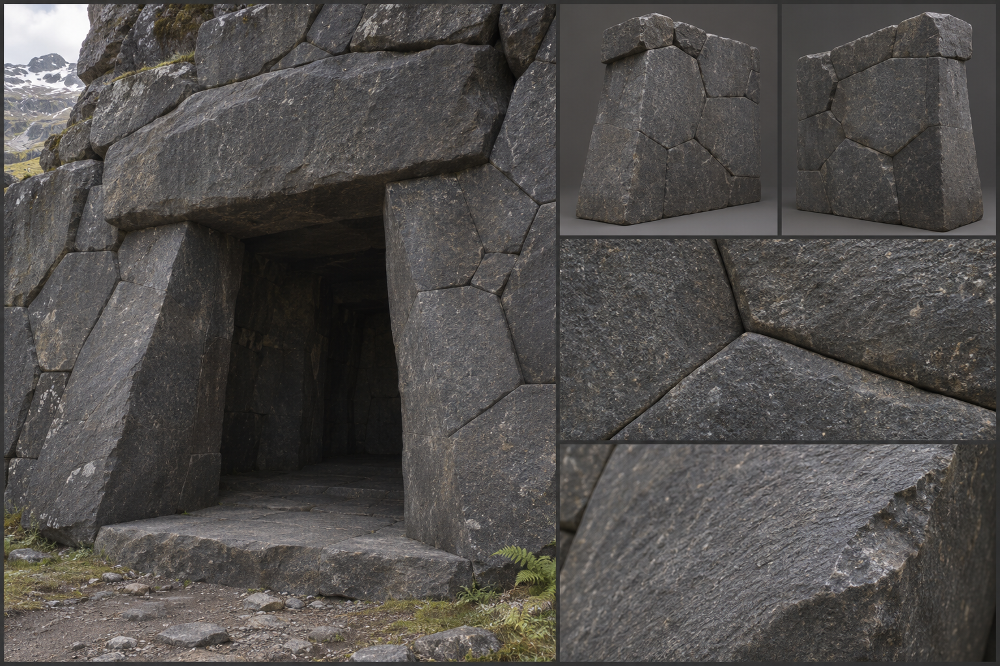

# Fitted Masonry

Fitted masonry is dwarven stonework: blocks cut to meet one another so exactly that no mortar is needed and no blade slides into the joint. It stands beside [dressed stone](Dressed-stone.md) in the material family as its master's version, trading speed for perfection of fit, and it is the signature of the [Dwarf](../../Races/Dwarf.md) holds described in [Dwarven Settlements](../../Structures/Dwarven-settlements.md). Dwarven builders raise it in the mountains and the deep places, and any player with the skill and the patience can build it anywhere. Its gameplay properties are set out under [Materials](../../Building-system.md#materials); this brief fixes only how it looks.

## Look at Eye Level

The wall is a mosaic of heavy blocks with joints that read as hairlines. Two styles share the material. In the squared style, blocks run 0,80 to 1,20 metres long and 0,40 to 0,50 metres high, with each course a different height and faces dead true to within a finger's width. In the polygonal style, five- to seven-sided blocks of 0,60 to 1,40 metres across interlock like the pieces of a puzzle, their edges following each other's curves, with no continuous horizontal course at all.

The faces are the dwarves' finest work: pecked and then ground smooth, with a very slight pillowed bulge on each block that catches the light and casts a thin shadow line at every joint. Colour is the mountain's own, dark slate-grey, blue-black basalt, cool grey granite, sometimes a dull red syenite, held to one family across a wall with only fine mineral speckle between blocks. Joints are 0,001 to 0,003 metres, so tight that dust and a thin line of shadow is all that shows. Mortar is absent, and a visitor sees nothing between the stones but the joint line itself. Large blocks show the faint tool marks of their dressing in a regular grain, and some carry a small mason's mark cut at the edge.

## Construction and Joints

Walls are battered, their faces leaning back a few degrees from base to top, which is the oldest dwarven answer to earthquake and siege. Corners are turned in the squared style by interlocking quoin blocks that overlap on both faces, and in the polygonal style by a bent block that wraps the corner. On the 3-metre module the wall is typically three courses of the squared style or about six to eight blocks of the polygonal style.

Openings are trapezoidal, wider at the sill than the lintel, with a single heavy lintel stone and jambs that lean in. Arches are corbelled or true, built from tightly fitted voussoirs with no keystone visible. Floors are slabs of the same stone, laid with the same hairline joints. Roofs, where a hold is built above ground, are low-pitched stone slabs on corbels or heavy slate. Timber is rare and appears only as metal-strapped door frames. Iron, bronze, and steel inserts are set into carved channels.

## Wear, Weathering, and Damage

Base wear is almost absent: the stone is dressed to outlast its builders, and the surface only polishes where hands pass and darkens with oil and soot from forges and lamps. Climate leaves little. Frost does not find joints to open, and rain runs off the pillowed faces in thin streaks. In the [Mountain Range](../../Biomes/Mountain-range.md) lichen takes a hold only in the carved grooves; in the [Deep Caverns](../../Biomes/Deep-caverns.md) mineral seep leaves pale calcite crusts and drips on the surface.

Damage is dramatic because the wall is so clean. The first sign is a hairline crack running through a block and across a joint, a clean fracture rather than crumbling. Then a block cracks across and a shard falls away, leaving a sharp-edged bite, and the neighbouring blocks, no longer held, shift and let daylight show along the joint. At the end the wall fails in whole slabs, a section peeling away to show the rough back of the blocks and the packed rubble behind. See [Damage and Siege](../../Building-system.md#damage-and-siege) for how the stages trigger.

## Variants

The squared style belongs to forge halls and gatehouses, the polygonal to retaining walls and cliff-faces where it fits the living rock. A hold's most honoured work carries inset runes or a single band of carved knotwork at head height. Human and elven builders who learn the craft copy the squared style in their own stone colours. Trims are described under [Decoration and Detail](../../Building-system.md#decoration-and-detail).

## Reference Set

A reference set for this material comprises an assembled wall section with a trapezoidal doorway at first-person eye height, front and rear of a representative wall piece and a corner piece, a close view of the hairline joint, a close view of a pillowed face and tool grain, a close view of a polygonal junction where several blocks meet, and a worn example with a fractured block. Each is shown under neutral and in-game light. The set avoids brick-pattern tiling, visible mortar, regular rectangles in the polygonal style, and the borrowed look of fantasy-game dwarven halls with cartoon runes and glowing seams.

## Continue Reading

See also: [Building materials](../Building-materials.md), [Art Direction](../../Art-direction.md), [Surface authoring](../Surface-authoring.md), [Dressed stone](Dressed-stone.md), [Warded stone](Warded-stone.md).

## Draft

<!-- Raw notes land here. Add new content in any form; an AI assistant reworks it into the body above as finished prose, then clears what it has integrated. -->
