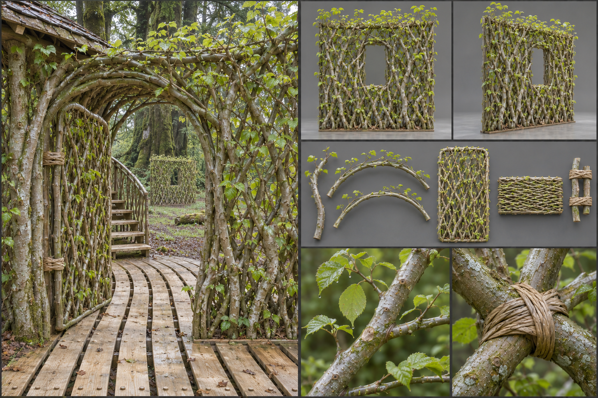

# Living Wood

Living wood is the elven way of building: trees shaped while they grow, boughs trained and woven into walls and floors, and cut timber used sparingly and only where it is fitted into a living frame. It is the elven expression of the family set out in [Materials](../../Building-system.md#materials), and the one that most clearly breaks the rule that a building is set on the ground rather than grown from it. As [Art Direction](../../Art-direction.md#shape-language-and-material-discipline) says, elven work is grown into the tree it hangs from rather than set on it, and the [Elven settlements](../../Structures/Elven-settlements.md) and the [Ancient Forest](../../Biomes/Ancient-forest.md) are its home. Its gameplay properties are in the building system and are not restated here.

The material is grounded and photographic. There is no glowing script and no floating light. The art direction's rule is that magic in this world acts on material things and leaves material traces, and for living wood the trace is quiet: wood that grows faster and more purposefully than it should, in the places the world's force runs closest to the surface.

## Look at Eye Level

A living-wood structure reads first as a tree and only second as a building. The trunks are those of the host forest, silver-barked beech and smooth-skinned ash at the lower stages, great buttressed trunks in the ancient forest itself, and the structure's walls are formed from branches and young stems of the same species, so no foreign wood appears. The colour range is that of living bark and wood: silver-grey to pale grey-brown bark, mossed green on the north and wet faces; the cream to pale green of freshly peeled cambium where a stem has been pruned; the honey and tan of seasoned shaped wood where it has been worked and oiled. Leaf and shoot add a spring-green note, since the walls are in leaf, and the lines of a wall change with the season, thinner in winter, dense in summer.

The stems of a wall are alive. Each one still grows from the host trunk, from a trained bough, or from a graft onto a neighbouring stem, so a wall shows no sawn or cut ends except where a stem has been pruned and healed over, and its leaves are the stems' own, not a creeper grown over dead sticks.

Units are curved and tapering. Wall stems are four to ten centimetres across at the base, tapering to two or three centimetres at the tip, and are trained in woven panels, with a stem passing over and under its neighbours at fifteen to thirty centimetres spacing, like a living hurdle. Larger members, such as floor beams and posts, are boughs twenty to forty centimetres across, grown or bent into the shape needed: a curved knee where wall meets floor, an arch over a door, a fork cradling a platform. None is straight for more than a metre. Surfaces are smooth where hands pass, rough where bark remains, and show the ridged scars of old pruning cuts, each a swollen ring where the tree has grown over the wound. Where two stems have been grafted, a thickened collar marks the join, with the bark running continuously across it.

Gaps are open and intended. Wall panels are woven loosely enough that light passes in dappled fragments, and in cold country the weave is packed with moss, bark, and clay, or lined with woven mats of bast and reed. Floors are split saplings or thin planks of pale ash and birch laid close and pegged, with a hand's width between boards to let rain through. Roofs are living: layers of woven branches and bark shingles, overlaid with leaves, moss, and creeping plants, so that from below the roof reads as a canopy.

## Construction and Joints

Joinery is the work of shaping rather than cutting. Stems are bent while green and held in place with withies and lashing of bark strip until the wood sets; two limbs are brought together and grafted by cutting matching faces and binding them, and over a few seasons they fuse. Where timber must be cut, as in a floor board or a door, it is fitted with pegs and wedges of the same wood, with no iron nails, and sometimes with a thin binding of copper wire or bronze at points of load, which greens with age. Hand-woven cord of bast and nettle takes the place of iron strapping.

On the 3-metre module, a floor is a pair of boughs or a cut beam spanning from one trunk-fixed bracket to the next, covered with boards. The wall piece is the woven living-stem panel alone, its feet seated in the floor frame by a notch and lashing, with an opening that is a clean reveal, an unwoven gap in the weave that reads complete with nothing fitted. The frame members are the trained boughs and posts that stand between panels, a post grown in a curve or a pair of bent saplings tied at the top for a corner, and the arch of two trained boughs, left with the bark on and gently asymmetrical, that frames a doorway. The fittings are the woven door panel or the slab of pale wood on pegged or bast hinges that closes the arch, and the woven mats that hang in a window gap or line a wall in cold country ([Fittings](../../Building-system.md#fittings)). Combined, a woven panel between two living posts, with an arch and a hung door, makes the characteristic bower wall, and a builder can save a doorway or a whole wall bay as a [pattern](../../Building-system.md#patterns). Stairs are wound around a trunk as a spiral of cut treads set into the bark, or are natural steps worked into a root flare; ramps follow a limb. Roofs are a canopy of woven shingle, pitched to the lean of the host branches.

The wood is never carved with machine accuracy. The tool marks are those of a draw-knife and a small adze, long thin shavings and faint facets, and the surface of a shaped member is hand-smoothed along the grain.

## Wear, Weathering, and Damage

Wear that belongs to the material is the wear of a living thing. Stems thicken each year, so lashings that were loose become embedded in the bark and are cut away and replaced; woven panels sprout shoots that must be trimmed; the bark darkens and ridges with age, and young grafts are lighter than old stock. A recently shaped structure looks raw, with bare pale wood at every cut, and in a season the cuts are sealed with a callus.

Climate shapes it further. In the cool, wet [Ancient Forest](../../Biomes/Ancient-forest.md), moss and lichen cover the north faces and ferns root in the roof, and the wood is dark and damp; the faint light of the forest's mana-fed lichen is the only glow, and it is a trace in the deepest shade, not a feature of the building. In the temperate [Forest](../../Biomes/Forest.md) the wall changes with the seasons, leafy in summer, russet in autumn, and bare in winter. In the [Jungle](../../Biomes/Jungle.md) and [Bamboo Jungle](../../Biomes/Bamboo-jungle.md), the growth runs thicker: vines cover the walls, and the shaped structure must be trimmed constantly to stay a building. Dryness is the enemy; in a drought leaves drop and the weave opens, and the wood greys and cracks.

Damage follows [Damage and Siege](../../Building-system.md#damage-and-siege), and living wood reads differently from dead timber. A cut stem bleeds pale sap and shows fresh wood, and a woven panel unravels from the cut, strands springing loose. Heavy blows splinter bough and break the lashings. Fire is the material's great weakness: green wood and leaf smoulder before they burn, and the structure gives off thick white smoke before it catches, then burns bright through the dry woven roof. A destroyed structure leaves a scar: severed boughs, scorched trunks, and bare branches where the building hung, and the tree itself, if it lives, begins growing new shoots from the wound.

## Variants

The ancient-forest style is the largest, built in the crowns of colossal trees, with platforms on boughs a metre or more thick, walkways on roots, and woven halls hung between trunks. The temperate style is smaller, built in beech and ash groves, with walls of woven hazel and ash and roofs of shingle. The warm, wet style in the jungle edge uses bamboo and cane in its weave, with pale, hollow stems and leaf-thatched roofs. In the cold north, the wood is denser and darker, with thicker weave packed with moss and a roof of turf.

Finishes from [Decoration and Detail](../../Building-system.md#decoration-and-detail) change only the surface of the same part: the choice of weave pattern, plain or lightly carved posts, and leaf-shaped shingles in pale and dark wood. Bone and antler fittings, hanging dried herbs, woven mats, and carved trims are fittings placed in their own right. Elven carving follows the grain: flowing lines along a bough, leaf and vine borders at the door arch, and low-relief figures of beasts, never flat geometric patterns. A builder can dress an elven piece in these styles without altering its strength.

## Reference Set

<!-- REVIEW(art-reference): Regenerate in the six-panel layout of the building-material-references recipes: a bare woven living-stem panel, and the trained boughs, arched door boughs, and woven door as separate parts. Also: Walls are cut sticks in a grid with ivy over them; they must be living stems still attached to the host, no cut ends, in their own leaf, with grafted collars at joins. The floor is tight grey decking; make it pale ash or birch with a hand's width between boards. Host trunk, arch doorway, spiral stair and bast lashing are right. -->

The reference set comprises an assembled example at first-person eye height: a woven wall and floor platform on a living bough, with a door arch, a stair, and part of a roof, in a host tree, seen from the walkway; front and rear views of the bare woven wall piece with nothing fitted, its opening a clean reveal, and of a floor section and a roof section, from the outside and from within; the frame members (a trained post, an arched door bough) and the fittings (a woven door panel, a bast-hinged door, a mat) each on its own; and close views of a woven weave, a graft collar, a pruning scar, a bast lashing, a peg and wedge joint, the cut end of a bough, and a roof's shingle with moss, in fresh, seasoned, and overgrown states. Each is shown under neutral and in-game light, including the cool, shaft-lit ambient of the ancient forest.

The reference avoids glowing blue tree-houses with luminous runes, white marble and gold filigree, uniformly smooth and polished wood with decorative curves of perfect symmetry, and a pristine, evergreen structure in which no leaf has died. It avoids the borrowed look of fantasy elven art with its swirling art-nouveau forms and light shows, and a green so saturated it reads as cartoon foliage. It avoids a structure that looks bolted onto a tree: the wood and the tree must share a bark. No fitting or frame member is merged into the wall piece: the woven panel is shown bare, and the arch boughs, doors, and mats stand apart from it.

## Continue Reading

Return to the [Building Materials](../Building-materials.md) hub, [Art Direction](../../Art-direction.md) for the global rules, and the [Surface Authoring](../Surface-authoring.md) standard, then continue with [Planked Timber](Planked-timber.md), the cut-timber work it borrows its pegs from, or [Thatch and Hide](Thatch-and-hide.md), the lashed and woven material nearest to it in method. Also see [Elf](../../Races/Elf.md) for the people who build it.

## Draft

<!-- Raw notes land here. Add new content in any form; an AI assistant reworks it into the body above as finished prose, then clears what it has integrated. -->
