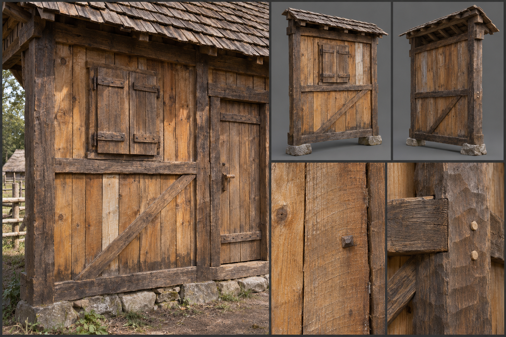

# Planked Timber

Planked timber is wood worked into a frame and boards and then treated to last: square-hewn posts and beams joined with pegs, riven or sawn planks fixed over them, and the whole finished with tar, oil, or pitch to hold off rot. It is the material between the frontier's [Rough Timber](Rough-timber.md) and the masonry above it, the stage at which a camp becomes a farmstead, a hall, or a stockade that is meant to stand for decades. It is the expression of timber that the building kit uses wherever the building system speaks of planked and treated work in [Materials](../../Building-system.md#materials), and the one against which a timber piece is judged. Humans, elves, and dwarves all build in it, differing in their joints and trims. The gameplay properties are in the building system and are not restated here.

## Look at Eye Level

Planked timber reads as framed and boarded, with a deliberate grid of heavy members and a skin of boards between them. It is made of the woods a pre-gunpowder carpenter would choose: oak for the frame and the sills, where strength and rot resistance matter; pine, spruce, and larch for the boards where they are plentiful; and chestnut, elm, or ash where the country allows. The colour range runs from the honey-yellow and pale tan of fresh pine and spruce to the red-brown of fresh oak and the warm orange of larch, and the working finish changes that range. Pine tar turns a board a deep brown-black with an amber edge where it thins; linseed or fish oil deepens the wood to a warm mid-brown and leaves a faint sheen that dulls within a season; pitch on the lower boards and the sills goes black and glossy. The surface of any one wall therefore moves between three or four tones, not one, since boards come from different trees and have been treated and replaced at different times.

Frame members are square-hewn: posts of fifteen to twenty-five centimetres across, beams of fifteen by twenty-five, the faces flat but never planed smooth, each carrying the long, shallow scallops of the broadaxe or the finer, parallel ripples of the adze. Edges are sharp but not razored, with a small arris, a few millimetres, knocked off by a draw-knife. Boards are the second language. They are sawn in a pit or riven, split along the grain with a froe, and fixed vertically, horizontally, or lapped. A board is two to three centimetres thick and fifteen to thirty centimetres wide, and widths in a single wall differ: a run of narrow boards beside a wide one, each with a slightly different thickness, so the face is not flat but rippled by a few millimetres at every seam. Sawn boards show the arcs of the pit saw's stroke in faint, regular curves; riven boards show long, wavy fibres and a slightly twisted surface, more splintery at the edge. Grain runs lengthwise and is clearly visible, with knots, some loose and dark, some replaced with a patch, and pale sapwood at an edge, where the log's outer ring ran. End grain shows where a board stops, in tight rings or dense pores, the oak ends darker and the conifer ends lighter, and the cut ends are left unprotected and often split, then dabbed with tar.

The frame stays exposed. Posts, sills, rails, and diagonal braces stand proud of the boarding by two to four centimetres, so a wall reads as a grid of heavy dark members framing lighter panels. Boards are overlapped, or fixed edge to edge with battens of five to eight centimetres covering the seams. Gaps of two to five millimetres between boards are permitted and expected, the width of a thumbnail, wider at the ends and narrower in wet weather as the wood swells. Joinery, repairs, and replaced boards show: a newer, paler board in a weathered wall, a patch nailed across a split, a rail with a spliced scarf joint.

## Construction and Joints

The frame is pegged mortise-and-tenon. A tenon cut at the end of a rail fits a mortise in the post, and a trenail, a round peg of oak or locust some two centimetres across, is driven through both through a hole drilled slightly off-centre so that it draws the joint tight. The peg ends show on the post face as pale round dots, usually in pairs, sometimes proud by a few millimetres, sometimes with a split end. Braces are halved or tenoned into post and rail at forty-five degrees. Boards are fixed to the frame with hand-forged nails, square in section, with a hammered head the size of a coin, rusting to a dark brown streak on the wood below. Iron straps, flat bars two to four centimetres wide, hold door hinges, gate frames, and the base of corner posts, and carry their nail heads in rows.

On the 3-metre module, a wall is a frame of two posts at the edges, a sill and a top plate, and a mid rail, with boards filling between. A corner is a single heavy post of twenty to twenty-five centimetres, the boards of each wall running into its faces. Where the post meets the ground or a foundation, the wall stands on a sill beam of oak resting on a stone or timber footing, kept a hand's breadth clear of the soil, and the lowest boards are the darkest, being tarred. A doorway is a pair of jamb posts with a lintel beam, and the door is of planks held by cross-battens and strap hinges, hung to leave a few millimetres clear at each edge. Windows are cut between posts and finished with a sill board and wooden shutters. Floors are sawn planks, twenty to thirty centimetres wide, laid on joists with face nails and left with gaps that narrow with damp, and roofs are rafters over a ridge beam with a sheathing of boards under shingles, riven oak or pine shakes in overlapping courses, or thatch.

## Wear, Weathering, and Damage

Wear that belongs to the material is subtle and appears early. Boards cup and warp slightly across their width as they season, pegs shrink and sit slightly proud or recessed, tar flakes and cracks in a crazed pattern at the edges, and nails weep rust. Door edges wear bright where hands push them, thresholds dip, and steps are polished and scuffed pale. A fresh finish is not clean; the surface keeps a haze of fine fibres and the odd drip of tar.

Climate then writes on the wall. In the [Forest](../../Biomes/Forest.md) and [Plains](../../Biomes/Plains.md), untreated faces silver in two seasons, and tarred ones stay dark and dull; the south face fades most, the north grows green moss in joints. In the [Jungle](../../Biomes/Jungle.md) and [Swamp](../../Biomes/Swamp.md), the foot blackens, algae spreads in thin green films above the tar line, boards at the sill go soft and are replaced, and the frame's pegs weep dark stains. In the [Tundra](../../Biomes/Tundra.md), the planks check along their length, tar stiffens and flakes, and frost sits in the gaps. Treated timber ages slowly, as [Weather and Environment](../../Building-system.md#weather-and-environment) puts it; an untreated board beside a tarred one marks the difference at a glance.

Damage follows [Damage and Siege](../../Building-system.md#damage-and-siege) and shows in stages. Axe cuts bite into boards as pale gashes and split them along the grain; nails pull and boards spring loose at one end, hanging by the other; pegs shear and a joint opens a gap that shows daylight; a post cracks at the mortise. A heavily damaged wall has missing boards, with the frame showing as an open lattice, braces snapped, and the whole panel racked out of square. Fire blisters the tar, then blackens the boards in a pattern that follows the grain and crawls up the frame, and a burnt panel leaves charred posts standing and a litter of burnt nails.

## Variants

Human work is the most plainly boarded, with horizontal clapboard or lapped weatherboard, a dark tar finish on barns and warehouses, and oil on halls, and the posts are left exposed. Dwarven timber is the heaviest and the squarest: posts over thirty centimetres, planks laid in tight edge-to-edge courses with iron straps at every joint and little decoration. Elven planked work is the lightest, with narrow boards of pale ash and birch fixed with pegs rather than nails, oiled to a pale honey, and always in the support of a living tree rather than set on a sill (see [Living Wood](Living-wood.md)).

Trims from [Decoration and Detail](../../Building-system.md#decoration-and-detail) let a builder leave a wall rough, plane it smooth, or carve it. The plain style shows the adze and the saw marks; the smooth style is hand-planed to a soft sheen with the grain highlighted; the carved style adds chip-carved borders, incised patterns on beams and bargeboards, and painted or stained panels in muted ochre, iron red, and soot-black.

## Reference Set

The reference set comprises an assembled example at first-person eye height: a plank-walled house or a hall with its door, a corner, and a window in view, and a roofline with shingles; front and rear views of a wall panel, a corner post, a door and frame, a floor section, and a roof panel; and close views of the board surface showing grain and saw or riving marks, the cut end grain, a pegged mortise-and-tenon joint, a forged nail and strap, a repaired board beside an original one, and a seam between boards, all in fresh, treated, and weathered states. Each is shown under neutral and in-game light, with raking sun, so that the board ripples and the slight offsets at the seams read.

The reference avoids the uniform board of the game-ready kit: identical widths, a single flat colour, razor-sharp edges, perfectly butted seams with no gap, no end grain, no visible fastening, a tiled grain, and no repair. It avoids the cartoon timber of stylised builders with their chunky bevelled edges and hand-painted wood grain, and it avoids a finish so even that it looks plastic or varnished. The single word photorealistic does not describe the kit; the colour range, the board widths, the exposed frame, the pegs, and the gaps above do.

## Continue Reading

Return to the [Building Materials](../Building-materials.md) hub, [Art Direction](../../Art-direction.md) for the global rules, and the [Surface Authoring](../Surface-authoring.md) standard, then continue with [Rough Timber](Rough-timber.md), the frontier material below, or [Timber and Plaster](Timber-and-plaster.md), the framed town work above.

## Draft

<!-- Raw notes land here. Add new content in any form; an AI assistant reworks it into the body above as finished prose, then clears what it has integrated. -->
