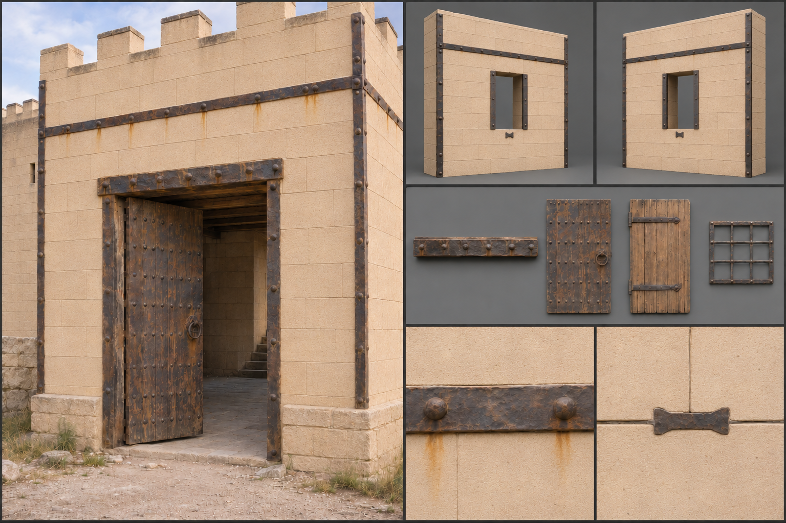

# Reinforced Stone

Reinforced stone is dressed stone bound with forged iron: bands round towers, straps across lintels, cramps between blocks, and studded plates over gates. It is the material of keeps, the top of the mundane ladder in the material family, and a smithy is as necessary to it as a mason's yard. Humans build it for castles and guild halls, dwarves for gatehouses and bastions, and any base that has to hold against a siege eventually reaches for it. Its gameplay properties are set out under [Materials](../../Building-system.md#materials); this brief fixes only how it looks.

## Look at Eye Level

The wall is [dressed stone](Dressed-stone.md) in regular courses, 0,60 by 0,30 metre blocks with fine joints, bound by a visible skeleton of iron that is part of every reinforced piece, never an optional dressing: the iron is what makes the wall reinforced. Bands of flat bar 0,08 to 0,12 metres wide and 0,01 metres thick run horizontally at each storey, set flush or standing a few millimetres proud, and are riveted or wedged into pockets cut in the stone. Vertical straps of similar width run down corners and either side of openings. Between blocks, small iron cramps, dovetail-shaped, show as dark rectangles bridging a joint at the top of a course, each bedded in lead. Gates and sally ports are faced with iron plates 0,005 metres thick studded with domed rivet heads in a regular grid, 0,10 to 0,15 metres apart.

The iron is hand-forged and shows it: hammer facets on the face, slightly uneven edges, a dark scale in the recesses, and a bright worn line where the edge has been handled. Newly set iron is blue-black; older iron is brown. The stone behind it is the same as any dressed stone, honey, grey, or buff, and the contrast between the pale stone and the dark fixings is the material's whole look.

## Construction and Joints

The iron belongs to the stone. A reinforced wall piece is a 3-metre module of [dressed stone](Dressed-stone.md) in regular courses with its iron built in: the dovetail cramps bedded in lead across the joints, a horizontal band once per panel at storey height, a vertical strap at each panel edge, iron jambs bolted through either side of an opening, and the washers of the anchor plates that tie floors to the wall. A corner piece carries the angle strap folded over its quoin and pinned on both faces. Because every reinforced piece carries the same band and strap positions, the iron of neighbouring pieces lines up into one continuous grid that matches the building's snap points, and a wall reads as reinforced from any distance. A dressed-stone wall without its iron is simply dressed stone, a lower material. The opening is a clean reveal framed by its iron jambs, with a stone arch coursed in where one is wanted.

The frame members are the stone or timber lintel laid across an opening, which in this material carries its iron lintel plate, and the heavy timber floor beams on stone corbels. The fittings are what fills the openings: the gate and sally-port leaves faced with studded iron plating, doors on strap hinges, and window bars; see [Fittings](../../Building-system.md#fittings). A keep's banded walls with a studded gate and barred slits are a combination a builder saves as a [pattern](../../Building-system.md#patterns).

Wall tops carry iron-shod timber hoardings or stone battlements with iron-bound merlon caps. Doors are timber layered in two directions, banded and studded, hung on strap hinges that run most of the way across the leaf. Windows are narrow and set with iron bars through the stone, their ends leaded into the sill and head.

## Wear, Weathering, and Damage

The iron is the first thing to age. Fresh bands are dark and clean; within a season rain brings out orange rust at rivet heads and edges, and the rust runs in long rust-red streaks down the stone below each band and strap, staining the pale blocks beneath. Where iron is packed into damp stone, rust swells and spalls the face around it in small flakes. In the [Coast](../../Biomes/Coast.md) and the [Swamp](../../Biomes/Swamp.md) the streaking is heavy and rapid; in the [Scorching Desert](../../Biomes/Scorching-desert.md) iron stays dark and the stone bleaches. Maintained work is blacked with oil or tar and shows little rust, which tells the viewer whether a keep is lived in.

Damage reads in two layers. Stone around the iron cracks first, because iron is stiffer than the masonry it grips, and the first mark of a breaking wall is a shattered face around a bent band. Then a strap tears free and hangs by one rivet, the blocks it held bulge, and a section of wall falls inside its iron cage, leaving bent bands and straps sticking from the rubble like ribs. See [Damage and Siege](../../Building-system.md#damage-and-siege) for how the stages trigger.

## Variants

Human keeps carry plain flat straps in black, with a single heraldic plate over the gate. Dwarven bastions use thicker bronze and steel bands with chiselled edges and recessed rivets, and are kept bright. Guild halls may paint the iron red or black, hang painted wooden shields from the bands, or add a bronze cap to each rivet. Finishes change only the surface of a piece and never add a part: for this material they are the stone's tooled face and the iron's blacking, oil, tar, red or black paint and bright polish. Heraldic plates, bronze rivet caps and painted wooden shields are trim fittings, placed as pieces of their own. The rules are described under [Decoration and Detail](../../Building-system.md#decoration-and-detail).

## Reference Set

<!-- REVIEW(art-reference): Regenerate in the six-panel layout of the building-material-references recipes: the wall piece keeps its built-in iron (band, edge straps, iron jambs, cramps, and the angle strap on a corner piece) but has no gate or door fitted; show the lintel with its iron plate, the studded gate leaf, the strap-hinged door, and the window bars as separate parts. Also: Small iron crosses are scattered over the block faces; cramps belong only across joints at the top of a course. Strap hinges stop halfway; run them most of the way across the leaf. Bands, rivets, corner straps, studded gate and rust are right. -->

A reference set for this material comprises an assembled keep wall with a banded gate at first-person eye height, the reinforced wall piece and a corner piece, front and rear, with their built-in bands, straps, angle strap, iron jambs, and cramps and with nothing fitted in the opening, the lintel with its iron plate, the studded gate leaf, the strap-hinged door and the window bars each on their own, a close view of a band and its rivets, a close view of a cramp across a joint, a close view of rust staining on stone, and a worn example with a torn strap and bulging blocks. Each is shown under neutral and in-game light, dry and rain-wet. The set avoids uniform clean metal trim, rust-free iron on old stone, decorative bolts without function, and the borrowed look of studded fantasy fortress kits. No fitting or frame member is merged into the wall piece, and no reinforced piece is shown without its iron.

## Continue Reading

See also: [Building materials](../Building-materials.md), [Art Direction](../../Art-direction.md), [Surface authoring](../Surface-authoring.md), [Dressed stone](Dressed-stone.md), [Warded stone](Warded-stone.md).

## Draft

<!-- Raw notes land here. Add new content in any form; an AI assistant reworks it into the body above as finished prose, then clears what it has integrated. -->
