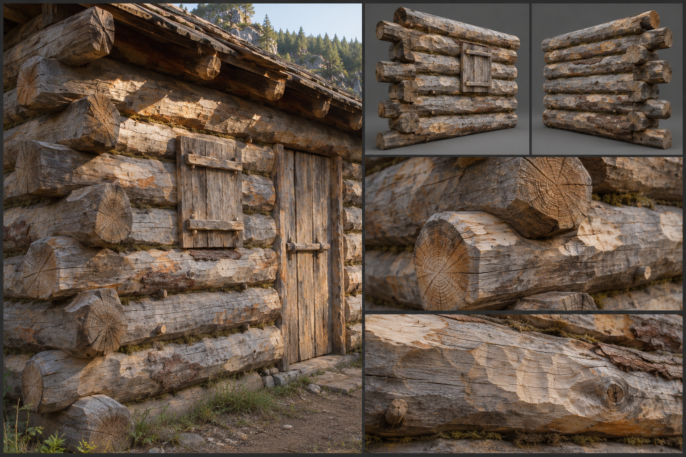

# Rough Timber

Rough timber is the frontier's backbone: whole logs felled, trimmed with an axe, and stacked or stood into walls by people who need a roof and a defensible wall more than they need a finish. It sits one step above [Thatch and Hide](Thatch-and-hide.md) in the family set out in [Materials](../../Building-system.md#materials) and one step below [Planked Timber](Planked-timber.md), and it is the material the first outposts, palisades, watchtowers, and hunters' cabins of every people are made from. Its look is defined by what the axe leaves, not by what a saw would have made. The gameplay properties of the material are in the building system and are not restated here.

## Look at Eye Level

Rough timber reads as heavy, round, and pale. Logs are conifer where the country allows it, pine, spruce, larch, and fir, which grow straight and long, and oak, chestnut, or poplar in the temperate woods where conifers are scarce. They are twenty to forty centimetres across, and a 3-metre wall panel is built from six to nine courses of them. Some are left round with the bark on; most are stripped in the building season, so the wall shows a mix of grey-brown ridged bark in patches and pale wood beneath, with the thin inner bark, the cambium, showing in streaks of cream and orange. Others are barely squared, hewn on two faces with a broadaxe so that the wall presents a flat, slightly dished face of eight to twelve centimetres of wood outward and a rounded back.

Fresh wood is pale: the cream to straw-yellow of spruce and pine, the light brown of larch, and the paler tan of green oak, with resin weeping amber from knots and cut ends. The colour changes quickly. Within the first season the surface silvers; by the second year the outer faces are a mid grey, streaked darker where water runs, while the sheltered underside of an eave or the inside of a wall stays honey-gold. Axe marks are the dominant surface texture: shallow scallops six to ten centimetres long, running slightly diagonally where the hewer stood, each with a crisp cut edge on the fresh wood and a rounded one on the old. The grain shows through as long streaks, with knots standing proud or dark, and checks, the drying cracks that open along the log's length, run a hand deep and a finger wide in the thicker timbers. Log ends are rough: axe-cut, with a slightly pointed or chiselled profile and a visible ring pattern.

Gaps are part of the look. Where logs stack, a gap of one to three centimetres is common and is chinked, stuffed with moss, a mix of clay and chopped straw, or oakum of twisted bark fibre, which shows as a dark irregular line between the courses. Fresh moss chinking is green, clay chinking a pale ochre that cracks and falls away in patches. Daylight can be seen through a neglected wall.

## Construction and Joints

The defining joint is the saddle notch. A round log at the corner is cut with a shallow cradle on its underside, five to ten centimetres deep, that seats over the log below at right angles; the log ends project twenty to forty centimetres past the corner and stand out as the building's signature, a stepped, alternating stack of rounded ends. Where the builder squares the logs, the corner may instead be dovetailed or half-lapped, with the ends cut to a tapered notch, but even then the ends are left long and the cuts show the axe. No nails hold the courses together; instead, wooden pegs of oak or locust, two to three centimetres across, are driven vertically through drilled holes at intervals of about a metre to pin one log to the next, and their flush or slightly proud ends are visible along the face.

On the 3-metre module, a wall is a stack of courses cut to length at each end, with the lower log resting on a foundation of stones or a sill log, and a doorway is formed by cutting the courses short and fixing them to a pair of upright jamb posts that run to the lintel with tongue-and-groove slots or spikes. The door itself is a few split planks held by two straps and a cross-brace, hung on wooden pins or hand-forged strap hinges. Windows are small, a log-height or two tall, a slot with a shutter. The floor is either packed earth, a layer of split logs laid round side down with the flat face up, called puncheon, or hewn planks on log joists. Roofs begin as a ridge log and purlin logs that rest on the gable-end log courses, stepped inward, and on them rafters carry bark, sod, split shakes, or thatch; the log rafter ends project over the eave in a row of round or chopped ends.

## Wear, Weathering, and Damage

Wear that belongs to the base material appears early. Fresh logs shed bark in strips, exude resin, check as they season, and settle: a new log wall compresses three to five centimetres over its first year as the courses dry and bed down, so the chinking shifts and the door is trimmed to fit. The surface silvers in weeks of sun. This is the look of the material, not of neglect.

Climate then takes over. In the [Forest](../../Biomes/Forest.md) and the [Plains](../../Biomes/Plains.md), the wall greys evenly and the foot of the logs darkens where the soil splashes back; lichen, orange and pale green, takes the north face and the roof edge. In the [Swamp](../../Biomes/Swamp.md) and [Jungle](../../Biomes/Jungle.md), the lower courses go black and soft, moss and algae coat the base, fungus brackets push from the bark, and the sill log is the first to rot; the wall's foot shows a damp stain a metre high. In the [Tundra](../../Biomes/Tundra.md), the wood stays pale and hard but cracks deeply in frost, and snow sits on the roof and against the wall's north face in banks. In a dry climate the surface splits and fuzzes, with long open checks and a fine bleached grain.

Damage follows [Damage and Siege](../../Building-system.md#damage-and-siege) and reads clearly. Axe cuts open pale, fresh wedges in the weathered grey and are the brightest marks on the wall, since the wood beneath is untouched by weather. A wall under sustained attack shows deep chopped notches that merge, splintered logs with long torn fibres, and logs knocked from their pegs and hanging at an angle. Fire chars the surface to a black alligator-hide pattern of cracked squares, the logs smoulder at the ends, and a burnt wall remains standing as a charred, shrunken stack for a long while before it falls.

## Variants

The conifer style of the north and uplands uses long straight spruce and larch with minimal squaring and heavy moss chinking, giving a dark, round-log look. The hardwood style of the temperate woods uses shorter oak and chestnut, more often hewn on two faces, with clay chinking. Pole-and-palisade work, used for fences and enclosures, stands whole trunks upright side by side, set in a trench and sharpened at the top, with their bark left on and the points cut by hatchet in four or five facets. Frontier towers and blockhouses overhang their upper storey by half a metre on projecting log ends.

Trims from [Decoration and Detail](../../Building-system.md#decoration-and-detail) are practical: a builder can choose bark-on or stripped logs, round or half-squared, moss or clay chinking, and shingle, sod, or log roofing. Carved gable ends, painted door frames, and antler or skull mounts are added by taste, and an upgrade to planked work leaves the log structure behind as a sill.

## Reference Set

A reference set comprises an assembled example at first-person eye height, a small cabin or a stretch of palisade with a door and a corner in view, its roof visible at the eave; front and rear views of a wall panel, a corner, and a doorway; and close views of a saddle notch with the projecting log ends, a stretch of chinking, the axe-marked face of a hewn log with its checks, the cut end of a log, a peg, and the same logs in fresh, silvered, and rotted states. Each is shot under neutral and in-game light, with low sun raking across the axe marks.

The reference avoids machined cylinders of identical diameter, bark that is a repeating tile, perfectly clean cut ends, and a single flat brown. It avoids the stacked-log cabin of other survival builders with its uniformly tiled round-log texture and mass-produced, identical corner ends, and it avoids a pale fresh-cut finish on a wall that is meant to be a year old.

## Continue Reading

Return to the [Building Materials](../Building-materials.md) hub, [Art Direction](../../Art-direction.md) for the global rules, and the [Surface Authoring](../Surface-authoring.md) standard, then continue with [Thatch and Hide](Thatch-and-hide.md), the cruder material below, or [Planked Timber](Planked-timber.md), the finished work above.

## Draft

<!-- Raw notes land here. Add new content in any form; an AI assistant reworks it into the body above as finished prose, then clears what it has integrated. -->
