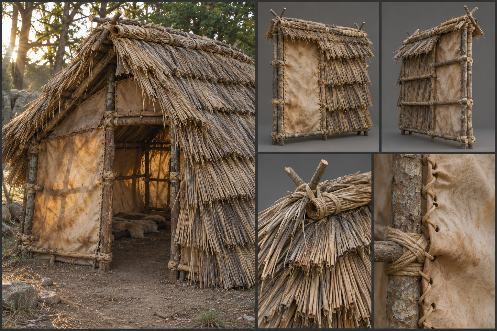

# Thatch and Hide

Thatch and hide is the first material a builder reaches for and the last they trust: lashed poles under a skin of bundled reed, straw, or sewn animal hide, raised in an afternoon from what the country offers. It sits at the bottom of the family set out in [Materials](../../Building-system.md#materials), below [Rough Timber](Rough-timber.md), and it is the material of the first night, the hunting camp, the herder's shelter, and the outlaw hideout that may have to be abandoned by morning. Every people builds with it when speed matters more than permanence, and the nomadic and the desperate build with little else. The gameplay properties of the material, its resistance, its weight, and its cost, are set out in the building system and are not restated here; this document describes only what it looks like.

## Look at Eye Level

The first impression is of softness and irregularity, the opposite of the squared work above it in the family. Poles are whole young trees, ash, hazel, alder, or pine saplings felled green, four to ten centimetres across at the thick end and left with their bark on, which is grey-brown to silver on the older stems and a raw yellow-green where a branch stub has been trimmed. They are never perfectly straight; a bend in a pole is left where it falls and the builder works around it. The poles of a 3-metre wall panel stand roughly forty to sixty centimetres apart, lean a few degrees off true, and are bound to horizontal rails at knee, waist, and shoulder height.

Thatch is the main surface. Reed from a marsh or river margin is the pale gold of dry straw when freshly laid and weathers within a season to a mid grey-brown; cereal straw is a warmer yellow and greys faster; coarse grass and bracken, used where nothing better grows, are a dull olive-brown. Bundles, called yelms in a thatcher's trade, are about fifteen to twenty-five centimetres thick, laid in overlapping courses from the foot of the panel upward, and each course is pinned with split hazel withies, or sways, so that the face reads as a band of horizontal shadow lines every twenty to thirty centimetres. The face is combed but not trimmed to a ruler: stalk ends stand out in a ragged fringe, bundles differ in width, and a handbreadth of the course beneath shows at every seam. Eaves hang forty to sixty centimetres past the wall and end in a thick, uneven, shaggy edge.

Hide walls are the same frame with a different skin. Cattle, deer, and elk hides are scraped, stretched on the frame while damp, and laced to the rails with sinew or rawhide thongs through punched holes five to eight centimetres apart. Fresh, they are a pale cream to tan, translucent when the sun is behind them, and marked with the ghost of the animal's pattern, the darker back, the paler belly, the shape of the legs. Aged and smoked, they turn amber, then brown, and a hide that has hung above a hearth is nearly black at the top and dark honey lower down. The seams where hides meet are stitched in coarse overhand rows, and the edges curl and pucker as the leather dries and takes up damp.

Nothing is hidden. The frame shows through the gaps between thatch bundles, the lashings stand out as thick wound knots of cord or green bark strip, and daylight is visible through any wall that has not been double-layered. Gaps of a finger's width are normal; gaps a hand wide mean the panel is failing.

## Construction and Joints

Everything is held by lashing. Poles are tied to rails with cord twisted from nettle, flax, or bast, or with strips of green willow, hazel, or rawhide thong, wound in a figure of eight five to eight turns deep and finished with a knot that is pulled tight as the binding dries. There are no nails and no pegs, and the joints give slightly under a hand. Where a pole is set into the ground, as at a corner post, it stands in a hole a forearm deep, packed with stones and earth, and a wall foundation is a ring of such stones laid dry around the foot.

On the 3-metre module, a corner is two poles lashed side by side at a right angle, tied top and bottom to a pair of rails, so that the corner reads as a bundle of poles rather than a single post. A doorway is a frame of thicker poles, lashed, with the thatch or hides stopping a handspan short of the jamb. A hide flap or a hurdle of woven withies fills it, and a window is only a gap in the course, tied off with a lintel pole. Floors are beaten earth under a layer of rushes, or a rough deck of split poles laid close and lashed to joists. Roofs are the clearest expression of the material: a ridge pole carries paired rafters lashed at the apex in a crossed fork, purlins run across them, and the thatch is laid in courses from the eaves up to the ridge, where a thick capping of folded bundles, pinned with crossed sways, sits over the join. The roof pitch is steep, around forty-five to fifty degrees, because thatch sheds water only when it runs quickly. A smoke hole is left at the ridge or a gable end rather than a chimney.

## Wear, Weathering, and Damage

Part of the wear belongs to the material from the first day. Green poles check and shrink as they dry, so lashings loosen within a few weeks and the builder retightens them; new thatch is bright and loose, with stalk ends shedding straw onto the floor until the surface settles; fresh hides sag and stiffen into a drum-tight skin as they dry, then slacken again in damp air. These changes are expected and are part of what the material looks like in its first season.

Later weathering depends on the climate. In the rain-heavy [Jungle](../../Biomes/Jungle.md) and the [Swamp](../../Biomes/Swamp.md), thatch greens and blackens with algae and mould from the lower courses upward and sheds in clumps, and the eaves sprout moss and small ferns; in the dry [Plains](../../Biomes/Plains.md) it bleaches to silver grey and the surface fuzzes with weathered stalk. In the [Tundra](../../Biomes/Tundra.md) snow sits heavy on a roof and tunnels beneath it where the hearth warms the thatch, and ice forms in the eaves. Hide stiffens and cracks in frost, and under strong sun it goes pale and brittle, splitting along the stitching. Birds pull straw from the ridge to line nests, leaving the capping ragged, and rodents work into the base.

Damage reads fast and unmistakably, as [Damage and Siege](../../Building-system.md#damage-and-siege) sets out for the material. Cut thatch shows slashed bundles and bare lashings; a hide wall shows slits that gape and flap. A damaged panel loses straw in handfuls that fall to the foot of the wall, then exposes the bare rails behind it, then the poles lean as lashings are cut. Fire is the signature of its end: thatch curls and glows along the lower courses, then runs upward in a sheet, throwing sparks and a dense grey-white smoke, and what remains is a blackened frame of charred poles, ash on the ground, and a few scorched hide scraps on the lashings.

## Variants

Reed thatch is the style of the river margins, the [Coast](../../Biomes/Coast.md), and the wetlands; it is the cleanest and longest-lived, with tight, even courses. Straw is the style of the farmland and the plains, warmer in colour and shorter-lived. Bracken, heather, and turf-capped thatch belong to the cold uplands and the tundra edge, where the roof is thick, low, and weighted with stones tied in nets along the eaves. In the [Bamboo Jungle](../../Biomes/Bamboo-jungle.md), split bamboo and broad leaves, such as palm and banana, replace grass, laid in shingled rows. Hide shelters follow the herding peoples and hunting camps: a cone of poles under hides, a lean-to with a single stretched skin, or a long low tent with a ridge pole and hide skirts weighed down with stones.

Trims from [Decoration and Detail](../../Building-system.md#decoration-and-detail) are modest. A thatch roof can be finished with a plain tied ridge or a decorative ridge of plaited straw knots, a hide wall can be painted with ochre or soot marks, hung with skulls, antlers, or braided cords, or left plain, and a builder can swap a smoke-stained hide panel for a pale new one in place.

## Reference Set

A reference set for this material comprises an assembled example at first-person eye height, a hide-and-thatch lean-to or a small round hut with its door and eaves in view, standing on bare ground; front and rear views of a representative wall panel, a roof panel, and a corner post, showing the frame from the inside; and close views of a thatch course with its pins and a ragged eave, a hide panel with its stitching and lacing, a lashing at a pole joint, and the weathered state of each in the same frame. Every view is made under neutral light and under in-game light, with low sun and with overcast, because translucent hide and the shadow lines of thatch change character completely between the two.

The reference avoids the clean, uniform, trimmed look of a hobby thatch or a heritage cottage, evenly cut straw with a ruler-straight edge, perfectly straight poles, and matching hide panels. It avoids the stylised teepee or the tribal hut of other survival games, with their repeating tiled straw textures and decorative bone and feather trim, and it avoids a bright saturated yellow thatch that no weathered roof would show.

## Continue Reading

Return to the [Building Materials](../Building-materials.md) hub, [Art Direction](../../Art-direction.md) for the global rules, and the [Surface Authoring](../Surface-authoring.md) standard, then continue with [Rough Timber](Rough-timber.md), the next material up the family, or [Clay and Adobe](Clay-and-adobe.md), the other quick builder's material of the dry country.

## Draft

<!-- Raw notes land here. Add new content in any form; an AI assistant reworks it into the body above as finished prose, then clears what it has integrated. -->
