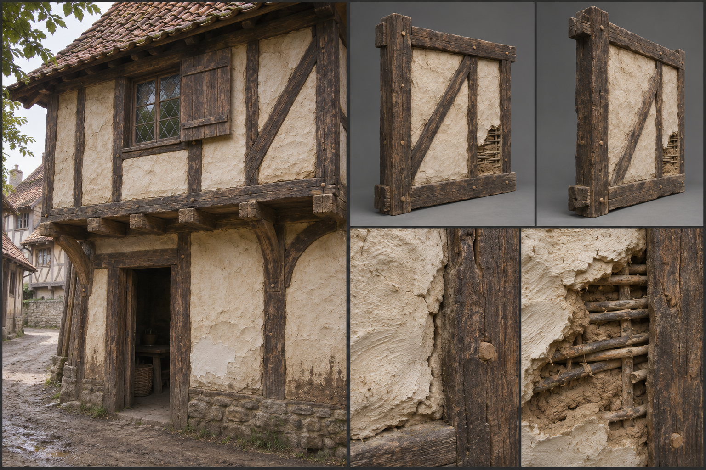

# Timber and Plaster

Timber and plaster is the building of the human town: a frame of oak, filled between its members with wattle and daub or with lime-plastered panels, and limewashed white or tinted. It is the material that makes a crowded street read as human at a glance, and it is the form in which the [timber work](Planked-timber.md) of the frontier becomes urban, with an upper storey, a jettied front, and a tiled roof. Humans are its builders, as [Human settlements](../../Structures/Human-settlements.md) set out, and it appears wherever a human town has grown past its first huts. It is one of the people-specific expressions of the family in [Materials](../../Building-system.md#materials); its gameplay properties are in the building system and are not restated here.

## Look at Eye Level

The wall is a pattern of dark and pale. The frame is oak, hewn square, with posts and studs fifteen to twenty centimetres across, rails of similar section, and diagonal braces that sweep from corner post to rail. Fresh oak is a warm gold-brown; within a few years the frame silvers to a grey-brown, and when it is tarred or treated with oil, as many town frames are, it is a deep brown-black, nearly flat in the shade and showing a faint red in sun. The panels between the members are thirty to sixty centimetres wide and 60 to 90 centimetres tall, so a 3-metre wall shows around five to seven studs and two or three rails, and they are filled in two ways.

Wattle and daub is the humbler fill: a lattice of vertical staves, split hazel or ash rods about two centimetres across at fifteen to twenty centimetres spacing, woven through with horizontal withies, then covered with daub, a mix of clay, sand, dung, and chopped straw, pressed on by hand to a thickness of three to five centimetres. It is topped with a coat of lime plaster and limewash. The surface is soft and slightly bulging, never flat, with the faint marks of the hand or trowel, a swirl, a drag, occasionally a scored pattern, and the edge where plaster meets timber is rounded and often slightly recessed or cracked. Brick or stone nogging, a fill of bricks laid in a herringbone or basket pattern, is the more expensive alternative in wealthy houses.

Limewash gives the panels their colour. Fresh limewash is a bright, slightly chalky white, thin enough to show the texture beneath; in a season it dulls to a warm off-white and then to cream, and tinted washes, which are pigments of ochre, iron oxide, or soot added to the lime, give pale yellows, soft pinks, warm greys, and muted terracotta. The tint is always a pale, earthy value, never saturated. The wash covers the plaster in uneven coats, leaving brush marks, thin places where the plaster shows grey, and splashes on the timber's edge.

The frame stands proud of the plaster by one to three centimetres. Upper storeys jetty, overhanging the lower by thirty to sixty centimetres on projecting joist ends and curved brackets, and the underside of the jetty, the soffit, is boarded or plastered. Beam ends, bracket tips, and sill ends are exposed and weather darker than the face. Windows are small and leaded, glass panes ten to fifteen centimetres across in lead cames, or shuttered; doors are heavy oak planks with strap hinges.

## Construction and Joints

The frame is pegged mortise-and-tenon, as in [Planked Timber](Planked-timber.md), with trenails driven through every joint; the pegs show on the post face as pale dots. Posts stand on a sill beam resting on a footing of stone or brick, the plinth, which is a half to a full metre high in a town to raise the timber from splashing ground. Floors between storeys are joists of eighteen by twelve centimetres, spaced forty to sixty centimetres apart and covered with boards, and their ends stick out at the jetty. Braces are halved or tenoned and run in a variety of patterns, an arch, a cross, a pair of diagonals, a curved brace, which give each house its character.

On the 3-metre module, a wall is a frame of posts at edges and middle, with a sill and a head, filled with panels, and a corner is a single heavy post carved in its face to accept the braces of two walls. A doorway is a pair of posts with a lintel and a door of oak planks; windows are cut between studs, with a timber sill and a lintel. The roof is a pitched frame of rafters and collar ties, boarded and covered in clay tiles in orange-red to brown-red, slates, or shingles, with a thick ridge tile and a slight overhang at the eaves; chimneys, where fitted, are brick or stone and stand outside the frame.

## Wear, Weathering, and Damage

Part of the wear belongs to the material from the start. Plaster shrinks as it dries and hairline cracks open at the interface with the timber, usually a millimetre wide and a hand long, and the wash on the lower panel is splashed with mud from the street. Oak twists as it seasons, and doors and window frames drift a little out of square. A new house is already imperfect.

Climate and age then show. In the temperate [Forest](../../Biomes/Forest.md) edge and the [Plains](../../Biomes/Plains.md), the limewash greys and chalks at the surface, green algae grows on the lower panels and under the eaves, and the frame silvers in streaks below the tile line. In the wet [Swamp](../../Biomes/Swamp.md) and [Coast](../../Biomes/Coast.md), the plaster takes damp from below, discolours in a dark tide line, and flakes, with the sill and lowest posts blackening. In the cold [Tundra](../../Biomes/Tundra.md), frost cracks the plaster in the panels and freezing water bursts the wash off in patches. Soot from chimneys and fires streaks the upper panels in dark grey. A town repairs steadily, and the wall shows it: a panel patched in a fresher, whiter plaster, a replaced stud in a paler timber.

Damage follows [Damage and Siege](../../Building-system.md#damage-and-siege) and shows in two layers. The plaster fails first: chips, cracks, and holes expose the woven lattice behind, with chunks of daub fallen at the foot of the wall. The frame then takes the blows, with braces snapped, studs broken, and the whole panel racked. Fire in a plastered panel behaves differently from bare timber, since the lime face resists the flame for a while; once it burns through, the frame glows and the infill falls out as a heap of charred stick and clay.

## Variants

Regional styles are marked by pattern and tint. The northern human towns favour close studding, studs set at only twenty to thirty centimetres, with little plaster visible and a dark tarred frame. The southern and river towns favour wider panels, whiter plaster, and a more open frame with curved braces. Coastal towns use tarred boards on the weather side and plaster on the sheltered side. In the dry country, where timber is scarce, the frame is thinner, the infill is clay-rich, and the walls are limewashed to reflect heat.

Trims from [Decoration and Detail](../../Building-system.md#decoration-and-detail) include the choice of brace pattern, plain white or tinted wash, painted or carved beam ends, a jettied or flush upper storey, and a guild or trade sign on a bracket. A plain wall can be dressed in place with braces and a mid rail, as the snapping of frames and braces allows, to turn it into half-timbered work.

## Reference Set

The reference set comprises an assembled example at first-person eye height: a two-storey street front with a jetty, a door, a window, and a tiled roof, in view with its neighbours; front and rear views of a wall panel, a corner post with jetty bracket, a door, and a roof section; and close views of the wattle lattice behind a broken panel, the surface of a limewashed panel with its brush marks and cracks, the join between plaster and timber, a pegged joint, a bracket end, and a roof tile course, in fresh, aged, and repaired states. Each is shown under neutral and in-game light, with overcast and low sun.

The reference avoids clean, flat white panels with razor-straight black timbers, as in a theme-park street, a repeating tile of the same timber pattern, and a uniform plaster with no cracks or hand marks. It avoids the picture-postcard Tudor colours of a fairy-tale village, and the chunky stylised beams of cartoon builders.

## Continue Reading

Return to the [Building Materials](../Building-materials.md) hub, [Art Direction](../../Art-direction.md) for the global rules, and the [Surface Authoring](../Surface-authoring.md) standard, then continue with [Planked Timber](Planked-timber.md), the frontier frame it grows from, or [Fired Brick](Fired-brick.md), the clay material that fills and replaces it in richer towns.

## Draft

<!-- Raw notes land here. Add new content in any form; an AI assistant reworks it into the body above as finished prose, then clears what it has integrated. -->
