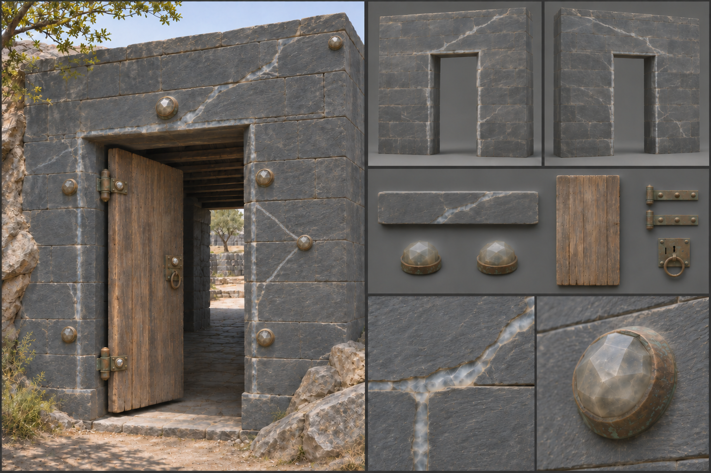
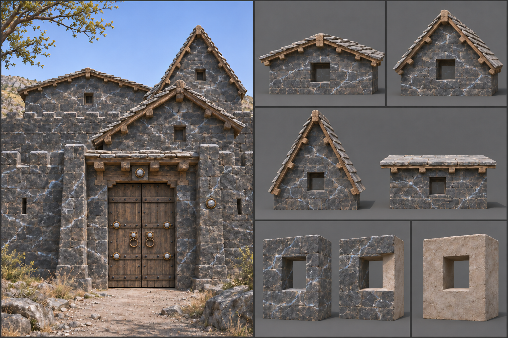

# Warded Stone

Warded stone is masonry laced with [mana crystal](../../Glossary.md#creatures-and-magic): veins and studs of the mineral set into the wall so that the structure itself holds and turns a charge. It is the rarest material in the family and joins late in a character's career, since the crystals must be harvested, cut, and set by a builder who understands [Magic](../../Magic.md). Dwarven masons set it into their deepest holds, elven builders into their stone halls, and human guilds into the walls of a hard-won citadel. Its gameplay properties are set out under [Materials](../../Building-system.md#materials); this brief fixes only how it looks.

## Look at Eye Level

By daylight the wall is first of all good dressed stone, 0,60 by 0,30 metre blocks in fine joints, in dark grey, blue-black, or slate. The crystal is a quiet addition to it. Veins of raw mana crystal, 0,02 to 0,05 metres wide, are inlaid into grooves cut along the joints and across the block faces in long, branching lines that follow the stone's own grain, as if the rock had split and healed with glass. Larger crystals, thumb- to forearm-sized, are set on the wall as separate studs that stand slightly proud, faceted, at the quoins, the lintel keystones, and the centre of each wall panel, each held in a collar of iron or bronze.

In daylight the crystal is a dull, cloudy, pale mineral: milky blue-white or smoky grey-violet, translucent at the thin edges and opaque in the thick, with a faint waxy lustre and a few hairline inclusions. It does not glow. It looks like quartz that has been rubbed with a thumb, and the sun lights it exactly as it lights the stone around it. Only close up does a viewer see small facets catching the light, or feel the faint coolness of the air near a large stud.

## Construction and Joints

The kit is separate pieces. The wall piece is the dressed stone wall with its veins, because the veins are part of the material: vein grooves are cut into the block faces before they are set, and the crystal is bedded in lime and then ground flush with the face, so a run of wall reads as a continuous, branching network that crosses panels without a break at the joints. Its opening is a clean reveal framed by a continuous vein that follows the jamb and head, and it reads complete with nothing fitted. The frame members are the stone lintel laid across an opening and the beams that carry floors. The fittings are the collared crystal studs, each a hosted piece in an iron or bronze collar, set in sockets at the quoins, the keystones and the centre of each wall panel, where the veins from neighbouring panels meet, and at each hinge and the lock of a gate; the gate leaf itself is a fitting too. See [Fittings](../../Building-system.md#fittings). Together they make the citadel gate, veined walls with a ring of studs round a studded gate, a combination a builder assembles as a [pattern](../../Building-system.md#patterns).

Where warded stone meets ordinary masonry the edge is a plain hard edge and the veins stop at the edge of the block, so a patched wall shows where the ward was cut; a builder who wants the join hidden sets a pillar, post, or trim over it. Roofs come in 27-, 45-, and 60-degree pitches and flat; a flat or 27-degree slab roof reads most characteristic. Floors and ceilings in warded rooms carry a crystal inlay border. Foundations are set on bare rock where they can, because the work is meant to sit close to the ground's own currents.

## Wear, Weathering, and Damage

Crystal and stone age at different rates. The crystal itself takes weather without loss, and its surface collects fine dust that dulls its lustre, so a neglected ward reads as grey chalk veins. The mortar and stone around it weather like any dressed stone. Tended warded stone is cleaned and the crystal kept polished, which is the visible difference between a living ward and a dead one. In the [Mountain Range](../../Biomes/Mountain-range.md) and the [Deep Caverns](../../Biomes/Deep-caverns.md) the crystal clouds with mineral film, and in the [Floating Islands](../../Biomes/Floating-islands.md) the same material is pale and bright from the high currents.

At night, and only when the ward is charged, the crystal takes on a faint inner light, a cold blue-white or violet no brighter than embers, the deep-current colour set out in [Art Direction](../../Art-direction.md#mana-in-the-frame). It brightens a few centimetres of the stone around each vein, and no more than a campfire. Damage reads as the veins failing. A struck wall cracks across its veins and the crystal fractures into sharp, bright shards; the light along the broken run gutters and goes dark, and the loose crystal gives off a little cold shimmer in the rubble. See [Damage and Siege](../../Building-system.md#damage-and-siege) for how the stages trigger.

## Variants

Dwarven warded stone is dark with straight, geometric veins set in bronze collars. Elven warded stone is pale and uses curved, branching veins that echo leaf and root. Human work is plain and functional: grey stone, a ring of studs, and veins that follow the joints. Finishes change only the surface of a piece and never add a part: for this material they are the vein pattern inlaid in the face, whether straight, curved or following the joints, the stone colour, and the polish of the crystal. A wall type offers its face combinations as part of these finishes, each face showing the material or a lining that suits it, chosen and changed in place without adding a part or changing strength; for warded stone they are veined stone on both faces, veined stone outside with a plain lining inside, and plain lined on both faces; the veins belong to the stone face. Carved mouldings and painted panels are trim fittings, placed as pieces of their own. The rules are described under [Decoration and Detail](../../Building-system.md#decoration-and-detail).

## Reference Set

<!-- REVIEW(art-reference): Refine the main plate's dark ashlar finish. A faint embossed swirl is still visible on some blocks, especially in the inlay close-up. Keep the flush unlit veins and the studs on the quoin, keystone, wall bay, hinges and lock. -->

A reference set for this material comprises an assembled warded wall with a gate at first-person eye height by day and by night, the bare veined wall piece and a corner piece, front and rear, with nothing fitted and the opening left as a clean reveal, the lintel frame member, the collared crystal stud and the gate leaf each on their own, a close view of a vein inlay, a close view of a crystal stud in its collar, a close view of the join between warded and plain masonry, and a worn example with a broken vein and shattered crystal. Each is shown under neutral and in-game light. The set shows the wall's face combinations and the roof at each pitch. The set avoids glowing runes, neon seams, floating particles, uniform bright crystals, and the borrowed look of fantasy-game magic walls. No fitting or frame member is merged into the wall piece.

## Continue Reading

See also: [Building materials](../Building-materials.md), [Art Direction](../../Art-direction.md), [Surface authoring](../Surface-authoring.md), [Reinforced stone](Reinforced-stone.md), [Fitted masonry](Fitted-masonry.md).

## Draft

<!-- Raw notes land here. Add new content in any form; an AI assistant reworks it into the body above as finished prose, then clears what it has integrated. -->
