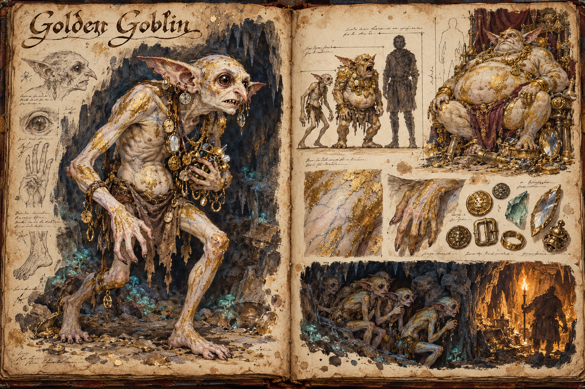
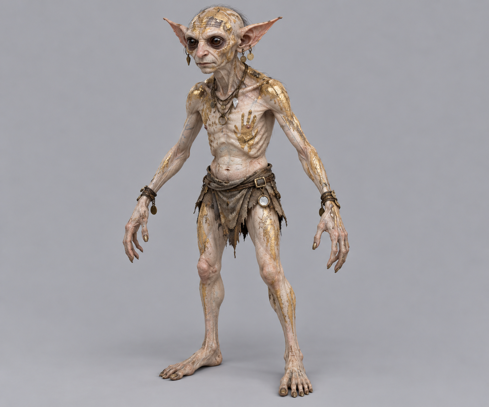

# Golden Goblin

Golden goblins are not golden at all. They are pale, skinny scavengers from the deep places of the world who paint themselves in glittering colour and live to collect anything that shines. They are the rarest of the goblin peoples and by far the most numerous where they gather: a colony can number a thousand, packed into the [Deep Caverns](../Biomes/Deep-caverns.md) around a hoard of gathered treasure. They hate a fair fight and flee from one at the first chance, and they would rather eat the dead than kill the living. What makes them dangerous is not any single goblin but the crowd, the dark they live in, and the patience with which they wait for something else to do the killing.

## Appearance and Visual Design

A golden goblin is a biped with two arms and two legs, about 1,40 metres tall, the same height as a [Green Goblin](Green-goblin.md), but far lighter at 25 to 32 kilograms. It is starved-looking even when well fed: every rib and knuckle shows, the limbs are thin as sticks, the belly is slightly distended, and the spine curves into a permanent stoop. The fingers and toes are long and grasping, the ears large and mobile, and the eyes huge, dark and wet, with pupils that swell to fill them in the dark and shrink to pinpricks in any real light. The mouth is wide and full of small, crowded teeth. It moves in a quick, crouching scuttle, often on all fours, and climbs cave walls and hanging roots as easily as it runs.

Beneath the paint the skin is a sickly pale white, almost translucent, with blue veins showing at the temples, wrists and chest, the colour of something that has not seen the sun for generations. Over it every golden goblin smears its paint: streaks, handprints and whole limbs daubed in a dull, flaking gold. The paint is ground pyrite and crushed mica worked into tallow, and it glitters convincingly in torchlight while being worth nothing. It wears thin at the elbows and knees, so the pale skin shows through in patches. Clothing is minimal, scraps of cloth and leather taken from corpses, but every golden goblin is hung with shiny things: buttons, buckles, coins, rings, bits of mirror and glass, polished nails and the brass fittings of lost gear, strung on cords around the neck and wrists and threaded through the ears.

## The Colony

A colony has three kinds of golden goblin. The Gleaner is nearly all of it, the scavenger that searches the passages, strips bodies and carries every scrap of shine home. The Hoard-warden is older and heavier, so caked in layers of gold paint that it has the cracked, glittering look of a gilded statue, and it guards the hoard caves, raising the shrill alarm that brings the colony running. At the centre of every colony sits the Gilded King, a grossly bloated goblin grown to about 2,20 metres and many times a Gleaner's weight on the tribute of its subjects. It is too heavy to do more than shift on a throne built from the hoard itself, and alone among its people it wears real gold, in heavy chains and rings sunk into the fat of its fingers.

The hoard is the colony's heart and the reason for everything it does. It fills whole caverns with heaped coin, plate, jewellery, armour fittings, glass and polished junk, almost all of it worthless pyrite, brass and trinkets. Real gold, silver and gems are buried among it, because a golden goblin cannot tell the difference and values both the same, so a player who reaches a hoard has to sort it to find the fortune inside.

## Behaviour and Encounter

Golden goblins are scavengers first and foremost. They seldom kill anything that can fight back; instead they find what has already died and strip it, eating the flesh and carrying off anything that glints. They are drawn to violence the way crows are, gathering at the edges of a fight in the dark and moving in once it is over. That makes them a real threat to a player who dies underground. A corpse left in their territory is found quickly, and by the time its owner makes the corpse run described in [Death and Loss](../Death-and-loss.md) it may have been picked clean of every shiny piece of gear, along with plenty that is not.

They live by darkness and are crippled by light. Torchlight makes them flinch and hold back at its edge, so a carried flame keeps a crowd of Gleaners at a distance, and darkness lets them creep close enough to snatch a dropped pack or a fallen weapon. Bright sunlight blinds them outright. They do come to the surface, but only at night, under heavy overcast, or in the deep shade of canyons, gorges and thick forest, and they retreat underground before the sun is high. On the surface they follow armies. A golden colony near red goblin country trails its [Red Goblin](Red-goblin.md) war-hosts at a distance, night after night, and strips the battlefields they leave behind, so a player who finds a field of dead stripped bare by morning knows exactly what came out of the ground to do it.

A golden goblin alone runs from almost anything. Struck, it shrieks and bolts, dropping whatever it is carrying, and a player can drive off a dozen with a few swings and a torch. A colony is a different matter. Threaten the hoard, or corner a crowd where it cannot scatter, and the shrill alarm of the Hoard-wardens turns a thousand cowards into a swarm. Hundreds pour out of side passages and down from the ceilings, biting and clawing and dragging at limbs, and a single goblin's weakness stops mattering. The warning is in the sound: the chittering of a colony grows silent just before the alarm, and a player who hears the passages go quiet near a hoard has moments to fall back to open ground or light enough fire to hold a line.

## Role in the World

Golden goblins are a low-tier threat on their own and a dungeon-scale one as a colony. Their home is the [Deep Caverns](../Biomes/Deep-caverns.md), and from there they burrow upward into the mines of the [Mountain Range](../Biomes/Mountain-range.md), both abandoned workings and active ones. The [Dwarven Settlements](../Structures/Dwarven-settlements.md) treat them as vermin, because a golden colony that breaks into a working mine strips its stores, its tools and its dead, and dwarven holds post standing bounties on them. That hostility belongs to dwarven culture, not to any player: golden goblins treat a player of any race exactly the same.

Their hoards are among the richest prizes underground and among the hardest to take, because reaching one means passing through a colony that will not fight until the moment it will. A cleared hoard yields real gold, silver, gems and the lost gear of everyone the colony has ever scavenged, mixed through heaps of fool's gold that can be sold only to the gullible.

## Story Hook

A mining camp at the edge of the mountains has been losing its dead. Bodies laid out in the cold store for burial are gone by morning, leaving only small bare footprints in the dust and smears of glittering paint on the door frame, and the miners are certain a rival crew is robbing them. The truth lies at the bottom of the newest shaft, where the camp's foreman broke into a natural cavern chasing a rich seam, saw what lived beyond it, and said nothing so the digging would continue. A player who finds the breach has to decide whether to seal it and close the seam with it, descend and break the colony to reach the hoard below, or leave the dead where the goblins can take them and let the mine keep working.

See also: [Creatures index](../Creatures.md), the [Deep Caverns](../Biomes/Deep-caverns.md) it lives in, the [Mountain Range](../Biomes/Mountain-range.md) whose mines it infests, the [Red Goblin](Red-goblin.md) war-hosts it trails, and [Death and Loss](../Death-and-loss.md).

## Concept Drawing

## Inspiration

The golden goblin is inspired by the goblins of Goblin-town in Peter Jackson's [*The Hobbit: An Unexpected Journey*](https://tolkiengateway.net/wiki/The_Hobbit:_An_Unexpected_Journey): pale, emaciated creatures swarming through the caves beneath the mountains in vast numbers, ruled by the bloated [Great Goblin](https://tolkiengateway.net/wiki/Great_Goblin) on his throne, which is the direct model for the Gilded King. What differs is the temperament. Golden goblins are cowardly scavengers rather than captors and torturers, they are blinded by sunlight rather than merely disliking it, and they are driven by a compulsion for anything that shines, which gives them the gold paint, the trinkets and the hoard that their film counterparts lack.

## Draft

<!-- Raw notes land here. Add new content in any form; an AI assistant reworks it into the body above as finished prose, then clears what it has integrated. -->
