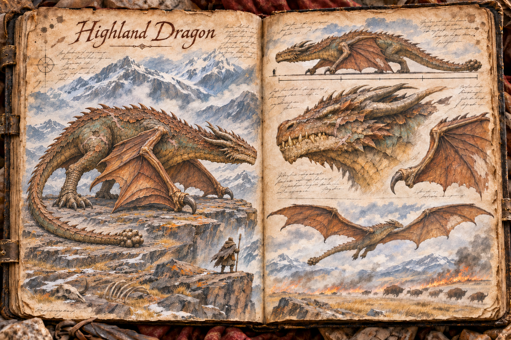
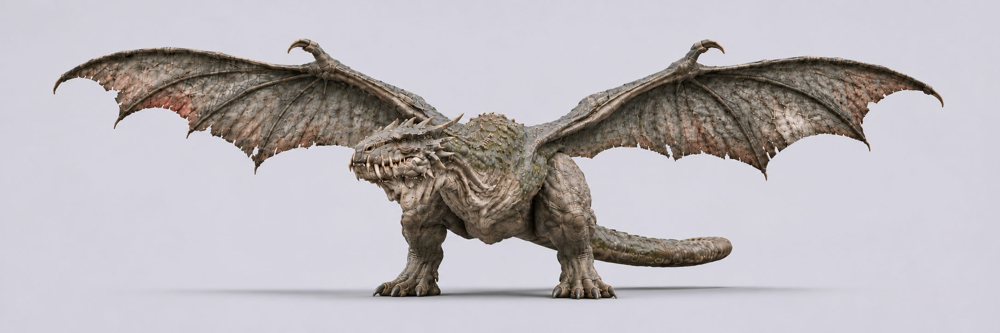

# Highland Dragon

The Highland Dragon is the oldest and largest winged predator in the world, a wyvern-bodied giant that roosts among the high ledges of the [Mountain Range](../Biomes/Mountain-range.md) and comes down, every few weeks, to hunt the big game of the lowlands. It measures about 40 metres from nose to tail, spans about 90 metres across the open wings, and weighs around 70 tonnes, so that an adult [Large Buffalo](Large-buffalo.md) is a meal it can lift and carry. Like the [Royal Dragon](Royal-dragon.md) it has two hind legs and two wings whose arm bones serve as its forelimbs, four limbs in all, but where the Royal Dragon judges and ceremonially spares, the Highland Dragon simply eats. It is not cruel and it does not hold grudges. It is hungry, it is enormous, and anything on open ground that is easier to take than a buffalo is worth its attention.

## Appearance and Visual Design

A Highland Dragon reads as age before it reads as anything else. Its body is long and heavy rather than sleek, with a deep, keeled chest, massive, hunched shoulders where the wings anchor, and a long, thick neck. That weight is bone and old, hard muscle, neither fat nor starved. Behind the chest the body tapers to firm, lean flanks and a narrower waist, the way an old bull or a great cat narrows behind the shoulders, and the thighs stay thick and powerful enough to launch seventy tonnes. Its ribs and hips do not show. Age shows in the skin, which hangs loose over a body still well fed on buffalo, not in wasted flesh. At rest it carries that neck in a high arch and lets the head hang down at the end of it, so that a dragon settled on a ledge forms a great hooped shape, like the mouth of a cave, with its head close to the ground. Age has loosened it. The neck has gone jowly, and the skin hangs in heavy, pendulous folds under the jaw, down the throat, and along the belly, creasing deeply at every joint like the hide of an ancient tortoise. Along the jaw, the throat, and the undersides of the neck and shoulders, the oldest folds have worn into ragged flaps and tatters of skin that hang loose and stir in the wind like a shaggy, rotten fringe. The skull is longer than a wagon, blunt and broad rather than pointed, with a heavy, rounded snout and a mouth crowded with yellowed, uneven teeth the length of a man's forearm that no longer sit neatly behind the lips. It has no single grand pair of horns. Instead a ragged ring of short, thick, backward-curving horns and spines frames the skull and the backs of the cheeks, uneven, chipped, and broken, no two alike from one side of the head to the other. Along the spine runs a line of low, worn ridges rather than tall spikes; whatever spines it had when young were broken or worn away long ago. The tail is nearly half its length and tapers to a heavy, blunt point.

Its colour is green, and a muted green. Across the back, neck, and tail the hide is a dull grey-green that reads as deep forest green in shadow and as sea green or faded olive in full sun, broken by darker, mossier patches along the neck and shoulders. Bronze shows only as a warm undertone where light catches the edges of the largest plates. The throat, chest, and belly are a pale grey-tan, ridged with deep transverse folds like the throat of a great whale. Nothing about it shines. The hide is crusted like the bark of an ancient tree: clusters of hard, grey-white growths cling along the spine, the shoulders, and the folds of the jaw like barnacles on a sunken hull, and here and there a few small, flat patches of pale lichen and flaking, scabbed skin break the flanks, with the green beneath darker wherever the crust has broken away. The crust is sparse and scattered; most of the hide is bare, creased green skin. Scars cross it everywhere: long pale seams from rivals, healed punctures, missing plates, and on most old dragons a torn and regrown patch of wing membrane that shows as a paler, thinner window when the sun is behind it. The membranes themselves are thick, leathery, and dark grey-green-brown, falling into deep, heavy pleats when folded, with dark veins that stand out in raised ridges; where the sun shines through a thin place or a hole, they glow a dull, bloody red. The eyes are small for the skull, a cold, pale green, and slow to move.

On the ground it carries itself like the Royal Dragon, low and nearly horizontal, walking on its hind feet and on the hooked claws at the wrists of its folded wings, with the membranes wrapped against its flanks like a sail furled on a mast. Concept art must read those front contact points as folded wings with a wrist claw, never as a pair of front legs. It moves slowly and with obvious weight; each step settles, and the tail drags a furrow behind it. In the air it is a different animal, a vast slow shape that beats its wings rarely and rides the wind for long stretches, so that from below it seems to hang in the sky.

At its size it cannot make a standing launch. In the terms of [Flight](../Flight.md#taking-off-and-landing) it is a drop-launch and run-up flyer: at home it simply falls from its ledge into the open air, and on flat ground it needs a long, clear strip of grass and a headwind, running with its wings half-spread and beating in great slow strokes that throw dust a hundred metres behind it.

## Roost and Rhythm

A Highland Dragon lives alone, high in the range, on a broad ledge or a cave mouth with a sheer drop beneath it. The roost is easy to recognise from far below once a traveller knows what to look for: a pale fan of cracked bone spilling down the rock beneath the ledge, streaks of soot on the stone above it, and no goats, birds, or [Stone Giants](Stone-giant.md) anywhere near. The only birds on that ledge are the small, drab ones that live on the dragon itself, picking at the crust along its back while it sleeps.

It feeds on enormous meals and then sleeps on them, sometimes for weeks. Between hunts it barely stirs, and a careful party can climb close to a sleeping dragon, which is the only reason its roost has ever been robbed. When it grows hungry again, it rises from the roost and circles the peaks for most of a day, turning slowly on the updrafts high above the range. That circling can be seen from the foothills and from the edge of the plains, and the people of the lowlands treat it the way sailors treat a red sky: herds are moved into the trees, pack trains are held back, and riders stay off the open grass until the dragon has fed. Its descents follow no season, so this day's warning is all anyone gets.

## The Hunt

The Highland Dragon hunts with fire. It does not breathe on its prey directly; it comes in low and downwind of a herd and lays a long line of flame across the grass ahead of it, walking the stream in a slow arc, then climbs and turns to watch. The grass catches, the herd panics, and a [Large Buffalo](Large-buffalo.md) stampede breaks away from the burning line. The dragon is waiting for the animal that falls behind: a calf, a lame bull, one cut off by the fire. It drops onto it with its hind talons, and either carries it off toward the peaks or, with an adult buffalo, kills it on the spot and feeds there on the ground. What it leaves behind is the sign every plains herder learns to read, a long scorched scar across the grassland ending in a ring of trampled, blackened ground and a picked carcass.

It is an opportunist, and that is what makes it dangerous to players. A horse, a pack buffalo, a hauling beast at the back of a caravan, or a rider alone on open ground is simply an easier buffalo, and the dragon takes whatever the fire flushes out. A player caught in a hunt has three things to watch. The tell for the fire is the dragon's line of approach: when it drops low over the grass and turns across the wind, the flame is coming, and the burning line will race downwind. The tell for the strike is the climb and turn that follows, which means it has chosen its target. The counter is to refuse to be the straggler. Get off the grass and onto stone, into water, or onto ground the fire has already burned, keep out of the stampede's path, and do not flee across open country on a mount the dragon can see. Dismounting into cover often saves the rider and costs the horse. In wet weather or the green of spring the grass will not carry the fire, and the dragon has to take its prey by stooping on it outright, which is slower, rarer, and far more likely to go wrong for it.

A dragon that has just fed is at its most vulnerable and its worst-tempered. Gorged and heavy on flat ground, it cannot simply leap back into the sky; it has to walk to firm open ground, turn into the wind, and run, and for the length of that run it is committed and exposed. This is the window in which guilds have brought one down, and the reason so few try. It defends its kill with sweeping blows of the tail, with sudden lunges far faster than its walk suggests, and with fire poured directly across anyone who comes close, and the grass around it is usually already burning. A wounded Highland Dragon breaks off and runs for the air rather than fight to the death, and an attempt that fails leaves an injured, very hungry animal circling the plains.

The body of a Highland Dragon is a fortune and a logistics problem. Its scales make armour plates that shrug off blades and scorch rather than burn, its hide and membranes are vast, its bones and horns are prized by carvers and builders, and its fire glands are sought by alchemists. Taking it all home from the middle of the plains, before rivals arrive, is a second operation as large as the first.

## Eggs and Raising

A Highland Dragon cannot be tamed. No adult has ever been bonded, and none ever will be. Its eggs are another matter. A dragon lays rarely and keeps its clutch deep in the roost, and stealing an egg means reaching that ledge, while the dragon is sleeping and while it might wake, and getting down again with an egg the size of a barrel. The parental bond of [Taming and Control](../Taming-and-control.md) is the only way a Highland Dragon has ever taken a rider, and it is an undertaking for a guild rather than a player.

The egg hatches only in steady hearth warmth, and the hatchling needs warmth and a roof until it fledges. After that it tolerates cold and mountain weather without complaint and needs no climate beyond cover. What it needs is room and food. It grows slowly over real months, and how slowly is a [server setting](../Server-settings.md#official-and-community-servers) with a long default. At about 15 metres from nose to tail it can carry a rider, and while it stays near that size it can still make a standing launch from a courtyard. As it grows toward its wild size it loses that ability, becoming a run-up and drop flyer that needs a long strip or a high tower to take off from, and its [shelter](../Building-system.md#shelter-for-creatures) has to grow with it, into a roofed stone hall the size of a keep with troughs that empty faster than any farm can fill them. A full-grown raised dragon eats like the wild one, whole carcasses at a time, and keeps its opportunist nature: it will take an unwatched horse as readily as a buffalo.

That cost is the design's answer to what a full-grown one can do. A raised Highland Dragon is the largest flyer a player can ride and the most devastating fire a guild can bring against a base under the [Building System](../Building-system.md#damage-and-siege), but it eats a settlement's surplus, it tires and must land like every flyer, its size makes it visible from any distance, and every launch and landing is a long, exposed operation that rivals can see and wait for.

## Gameplay Role

The Highland Dragon turns the sky above the lowlands into a weather system with teeth. Most players never fight one; they learn to watch the peaks, to read the scorched scars in the grass, and to plan a caravan around the days after a dragon has circled. For the plains it is the reminder that even the gentlest country has an apex above it, and for the [Large Buffalo](Large-buffalo.md) it is the predator that makes the herd's panic and stampede part of a living food chain rather than a reaction to players alone. For guilds it offers two of the largest undertakings in the game: bringing one down in the short window after it feeds, or robbing its roost and spending real months raising what hatches.

## Story Hook

A ford settlement on the edge of the plains has always lived with the Highland Dragon's rhythm, holding its herds back whenever the dragon circled the peaks and losing an animal or two a year to the fire. This season it comes down every few days instead of every few weeks, and it no longer bothers with the buffalo. It flies low over the farms and the road, burning lines across the fields, as if it were searching for something, and the scorched trails always end near the same wagon ruts heading east. A crew of egg-thieves came through the settlement a month ago with a covered cart and paid in good coin. The players can find the cart and carry the egg back up to the roost, hunt the thieves and keep the egg for themselves, or try to bring the dragon down before it burns the settlement looking for what it lost.

See also: [Creatures index](../Creatures.md), the [Mountain Range](../Biomes/Mountain-range.md) where it roosts, the [Plains](../Biomes/Plains.md) where it hunts, the [Large Buffalo](Large-buffalo.md) it preys on, the [Royal Dragon](Royal-dragon.md) for the other great dragon of the wild, and [Flight](../Flight.md) for its place among flying mounts.

## Concept Drawing

Alternate views include a [bestiary plate](../Assets/Creatures/Bestiary/highland-dragon-bestiary-v2.png) and earlier model references ([original](../Assets/Creatures/Model-references/highland-dragon-model-reference.png), [second version](../Assets/Creatures/Model-references/highland-dragon-model-reference-v2.png), [third version](../Assets/Creatures/Model-references/highland-dragon-model-reference-v3.png), [fourth version](../Assets/Creatures/Model-references/highland-dragon-model-reference-v4.png)).

## Inspiration

The Highland Dragon draws on [Vhagar](https://gameofthrones.fandom.com/wiki/Vhagar) from HBO's House of the Dragon, the oldest and largest living dragon of that series. It borrows her immense age and size, the slow, heavy flight, the high-arched neck and hanging head, the blunt skull framed by a ragged ring of short spines, the dull grey-green hide that hangs in folds and tatters and is crusted with barnacle-like growths and scars, the whale-like folds of the pale belly, and the wyvern body plan with wings as forelimbs. Her makers gave her a deep forest green hide and built her age from whale-like barnacle growths, the pendulous skin of a large tortoise, and a neck that grows jowly with years, as described in the [Television Academy's feature on the show's dragons](https://www.televisionacademy.com/features/news/mix/enter-dragons), and concept art for the Highland Dragon should lean on the same cues rather than on a tall crest, grand horns, or ornament. It differs in being a wild animal with no rider and no history among people: it is a lone predator of the mountains that hunts the plains for big game, uses its fire to stampede herds rather than as a weapon of war, and can only be ridden when raised from a stolen egg.

## Draft

<!-- Raw notes land here. Add new content in any form; an AI assistant reworks it into the body above as finished prose, then clears what it has integrated. -->
