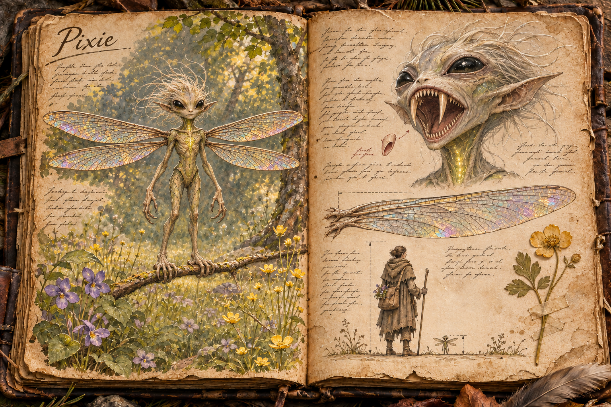
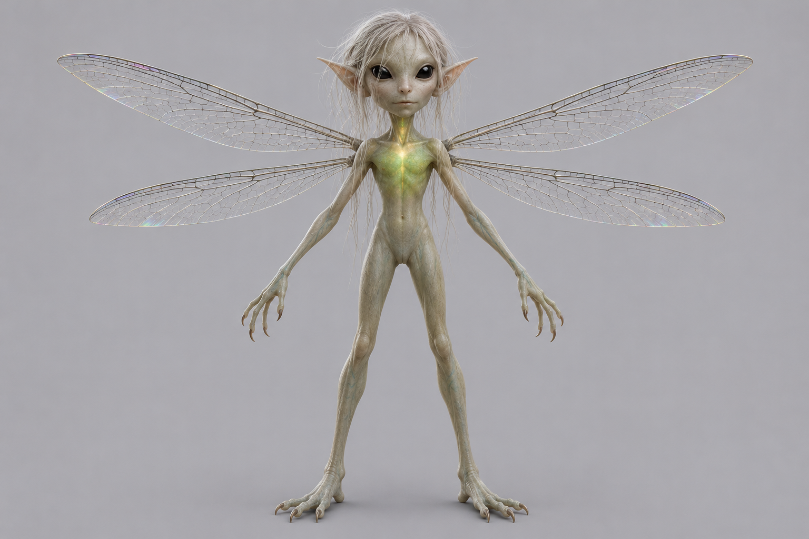

# Pixie

The pixie is a small winged creature of human shape, no taller than a person's head, that drifts over sunlit glades and through the green half-light under the canopy, glowing softly and chiming to its kind. From a distance it is the prettiest thing in the wood, and most players' first instinct is to walk closer. Up close it is a blood-drinker with a mouth full of needles, and the colony it belongs to is spread across the ground around it, every member listening. A single pixie is harmless to anyone who leaves it alone; harm one and every pixie within earshot arrives to drive the threat off, and a swarm of them can bleed a lone traveller to death in the time it takes to cross a meadow. The pixie teaches the lesson the wilderness most wants a new player to learn, that the beautiful places are dangerous too.

## Appearance and Visual Design

A pixie stands between 20 and 30 centimetres tall, the height of a human head, and weighs between 0,15 and 0,25 kilograms. Its body is a slender, long-limbed miniature of a human figure: two arms, two legs, a narrow torso, and a head slightly too large for the body, which is what makes it read as childlike from afar. The body is smooth and sexless, like a carved figure, with no clothing and nothing to clothe. The hands have four long fingers ending in hooked nails that grip bark, hair, and skin, and the feet are long and prehensile for perching.

Two pairs of wings grow from the shoulder blades, one above the other, built like a dragonfly's: long, narrow, stiff, and glass-clear, veined in a fine dark network that catches the light in rainbow sheens. The wingspan runs to about one and a half times the pixie's height, so a perched pixie, which holds all four wings flat out to the sides as a dragonfly does, is wider than it is tall, and that cross-shaped silhouette on a branch or a flower stem is the first thing a player learns to recognise. The wing pairs beat independently, which lets a pixie hover in place, rise straight up, slide sideways, and fly backwards. It launches standing, from any perch, and in flight its wings make a dry, papery hum that rises to a rattle when it darts.

The skin is pale and faintly translucent, bark-grey with a hint of green in the woods and greener in the jungle, so the veins show at the wrists and temples. Behind the breastbone sits a glow gland, a light organ that shines through the skin of the chest and throat in a soft green-gold. Fine pale filaments fall from the scalp like hair and lift in any breeze.

The face is where the illusion ends. From a few metres away the eyes look large and dark and gentle, and the mouth a small line. Closer, the eyes are solid black from lid to lid, without white or iris, and shine like wet stone. When the pixie opens its mouth the jaw hinges far wider than a human jaw could, to show two long, hollow upper fangs and rows of needle teeth behind them, and the small line of the mouth turns out to run almost from ear to ear.

## Colony and Signalling

Pixies live in colonies, but a colony is not a flock. Its members roam alone across a shared range, each one drifting, perching, and watching on its own, and a colony of a few dozen may be spread over several hundred metres of meadow or forest. They come together only at the nursery roost, a hollow tree or a split in an old trunk where the colony lays its eggs and the young stay until they can fly, and an intruder at the nursery is treated as an attack on the colony itself.

What holds the colony together is sound and light. Each pixie gives a soft contact chime every so often, a single bell-like note that carries a few hundred metres, and its glow gland pulses in time with it. Others answer. A glade with a colony in it is full of these faint notes and slow pulses of light, coming and going among the flowers, and it is one of the most peaceful places in the game to stand. Players who stay a while learn its rhythm, and learn to notice when it changes.

There are two other calls. A low, repeated note with a steady glow is the watch call, given when something large moves through the range at night; it falls silent once the thing has passed. The alarm is unmistakable: a shrill, rapid run of high notes with the glow flashing hard and fast. A pixie that is struck, caught, or cornered gives it at once, and a pixie that dies gives a last flare of light brighter than any call. Every pixie that hears the alarm or sees the flare comes. The pixie's reach is the reach of that sound, about 250 metres, so there is no clean way to kill one: an arrow that drops a pixie at forty paces still lights the glade.

## Feeding

Pixies drink blood, and they drink it only from sleepers. By day and at dusk they drift, sun themselves, and watch; at night they look for sleeping bodies in the open: deer bedded down in the grass, a herd of [Large Buffalo](Large-buffalo.md) at rest, roosting [Birds](Birds.md), [Four-Armed Monkeys](Four-armed-monkey.md) asleep in the jungle canopy, and people. A feeding pixie lands without a sound, folds its fingers into the hair or the clothing, and bites the neck, the wrist, or the inside of the elbow. Its saliva numbs the skin and keeps the blood running, and it drinks for a minute or two before lifting away at the first stir.

A single feeding never kills, and pixies do not feed on a body that is awake. A sleeper wakes paler, with lowered health and a few small paired punctures that bleed lightly for a while, as [Health and Wounds](../Health-and-wounds.md#bleeding) describes for a minor wound; several pixies on one sleeper in a night leave it weak. That applies to characters whose players have logged out, which sleep in the world under the rules of [Death and Loss](../Death-and-loss.md#logging-out): a player who logs out in an open glade where a colony ranges comes back with the marks on their neck. Pixies will not enter a space they cannot see out of. A tent with its flaps closed, a shelter with walls and a roof, or a cave with its mouth blocked keeps them off, which makes them one of the plainest reasons the game gives to sleep under cover.

The marks are readable on the land as well. A deer that runs with a lazy, unsteady gait in the morning, small paired wounds on the necks of a herd, and blood-flecked grass where animals slept all tell a hunter that a colony is near before they hear a single chime.

## Provocation and the Swarm

A pixie is curious and tolerant. It will hover a few metres from a player to look at them, follow a traveller along a path for a while, and perch on a fence post to watch someone work, and nothing happens as long as nobody touches it. Approaching does not provoke it; harming it does. Striking a pixie, catching one in the hand or a net, cornering one so it cannot fly away, or disturbing the nursery roost all raise the alarm. So does swatting at a feeding pixie on waking, which is how many first swarms begin: a player rolls over in the dark, slaps at something on their neck, and the meadow lights up around them.

Swarming pixies come in fast. They cruise at an easy 3 metres a second, but a pixie that darts reaches 12, and it holds that over any distance a player can run, so outrunning a swarm across open ground is not possible. In the sparse colonies of the [Forest](../Biomes/Forest.md) meadows an alarm brings a handful of pixies, perhaps ten; in the [Ancient Forest](../Biomes/Ancient-forest.md) and the [Jungle](../Biomes/Jungle.md) it brings ten to thirty.

The swarm does not fight like a predator. It envelops its target in a cloud of humming wings and flashing light, and each pixie in turn picks a patch of bare skin, the face, the neck, a hand, a wrist between glove and sleeve, darts in, bites, and tears away. Each bite is a small pierce that bleeds, and no single bite matters, but they come from every side, several a second, and the bleeding adds up faster than a player can bind it. Before a pixie darts it stops dead in the air for a heartbeat with its glow brightening, and when it comes from behind, where a first-person view cannot see it, the hum of its wings rises sharply at the player's ear. Armour matters more here than against almost anything else in the wild. Pixies look for skin, not for gaps a blade could use, so a hood, a scarf over the face, gloves, and sleeves that meet them turn a lethal swarm into a painful one.

Weapons are nearly useless against them. A sword stroke at a darting pixie mostly cuts air, and every kill flares the alarm again. What works is fire, smoke, and cover. A torch swept through the swarm scorches the thin wings and drives the nearest pixies back. Smoke, from a smoking green branch thrown on a fire or a smoke pot, blinds them to one another's glow and breaks the swarm apart, and a group that carries smoke into pixie country can walk out of an alarm that would kill a solo traveller. Dense cover saves a player too: the long, stiff wings cannot follow into a thorn thicket or a tangle of undergrowth, the swarm will not follow into a space it cannot see out of, and a player who throws themselves into deep water is beyond reach for as long as their breath holds, while the cloud hangs above the surface.

The swarm defends; it does not hunt. It attacks the body that raised the alarm and anyone else who strikes at a pixie, and it leaves alone anyone who does not, so a party member who stands still with their arms down is spared while the one who panics and flails draws half the swarm. Once the threat has left the colony's range by about fifty metres, or has stopped fighting and stood still long enough, the pixies break off one by one, the alarm fades back into contact chimes, and the glade is beautiful again.

## Pixies Beside a Settlement

Pixies cannot be tamed. They answer to no keeper and no bond under [Taming and Control](../Taming-and-control.md) reaches them. A colony that ranges beside a player settlement still gives that settlement something no stable can. Its watch calls mark anything large that moves through the dark, so settlers learn to read a low chiming at the woods' edge as a body passing, and a raider who brushes a pixie aside on the way in brings a swarm down on the raid. The same colony feeds on anyone who sleeps outside the walls and swarms any resident who swats one, so living beside pixies asks for discipline, sleeping under a roof, and children who are taught not to catch the pretty lights.

## Drops

A dead pixie yields its wings and its glow gland. The wings are stiff, light, and glass-clear, and [Crafting](../Crafting.md) uses them for fine fletching, for lantern panes that throw a soft rainbow light, and for ornament that sells well in the cities. The glow gland keeps shining for some days after it is taken, a cold light that needs no flame and lights no fire, and alchemists prize it as a reagent. The rest of the body is too small to be worth anything. Harvesting either means killing pixies, and killing pixies means alarms, so the materials are reliably expensive.

## Story Hook

A farming hamlet at the edge of the woods has always left bowls of milk on the sills for the little lights in the hayfield, and the little lights have always left the hamlet alone. This summer the hay-cutters who sleep out in the field wake grey and shaking, two of them did not wake at all, and the chiming at night has gone shrill and never stops. In a locked shed behind the house of a travelling lantern-seller who boards in the hamlet sit a dozen sealed jars, each with a pixie inside it, glowing faintly against the glass, bound for the city markets. The colony knows where its missing are, and the players must choose whether to free the jars and face the seller, hand the seller over to the colony at the field's edge, or burn out the nursery roost and end the matter the hamlet's way.

See also: [Creatures index](../Creatures.md), and the [Forest](../Biomes/Forest.md), [Ancient Forest](../Biomes/Ancient-forest.md), and [Jungle](../Biomes/Jungle.md) where its colonies range.

## Concept Drawing

## Draft

<!-- Raw notes land here. Add new content in any form; an AI assistant reworks it into the body above as finished prose, then clears what it has integrated. -->
