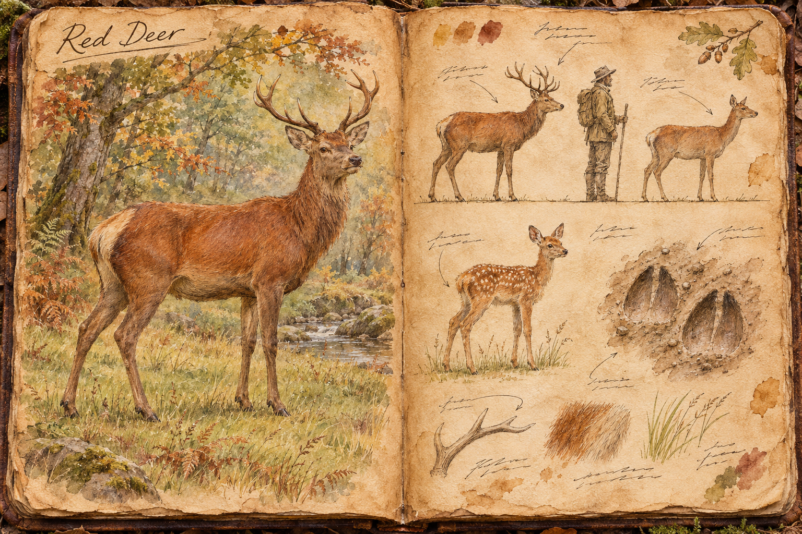
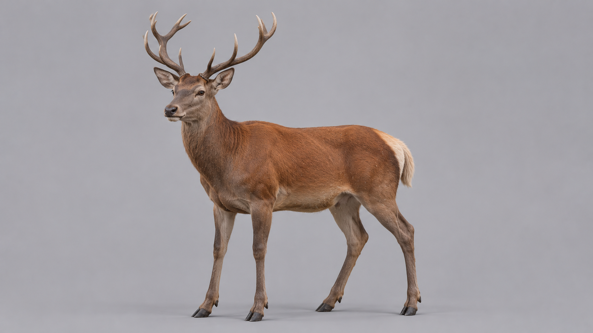

# Red Deer

The Red Deer is the ordinary game of the temperate wilds: a herd animal of woodland edge and open grass that feeds wolf packs, hunters and the whole chain of scavengers behind them. It is neither monster nor mount, and that is its purpose. Players meet it constantly, first as a flash of rump patches vanishing between trunks and later as the lesson in how a chase is won, because the deer is built to outrun nearly everything and is beaten only by an enemy that understands when it tires.

## Appearance and Visual Design

A stag stands 1,25 metres at the shoulder, runs about 2,00 metres from nose to rump with a short tail of 0,15 metres, and weighs between 160 and 200 kilograms. A hind is smaller, 1,05 metres at the shoulder and 110 to 130 kilograms, with a finer head and no antlers. The build is long-legged and deep in the chest, with narrow cloven hooves, a slim neck and large, mobile ears that swivel independently towards every sound.

In summer the coat is a warm reddish brown across the back, flanks and neck, shading to pale buff on the belly and the insides of the legs, with a cream patch on the rump that flashes when the animal bolts and tells every deer behind it which way the herd has gone. In winter the coat thickens and dulls to a grey brown, the rump patch fades to dirty white, and the stag grows a shaggy darker mane on the neck. Calves are born in early summer, russet and dappled with white spots that let them disappear into dappled undergrowth, and they lose the spots before their first winter.

A stag's antlers are the only feature that changes with the calendar (see [Weather, Time, and Seasons](../Weather-time-and-seasons.md)). They are cast in late winter and regrow through spring and summer under a soft, velvety skin, hardening and shedding that velvet by autumn into a bone-brown crown of up to six points a side with a span of about 0,90 metres. A stag in velvet carries antlers that are warm to the touch and fragile, while a stag in autumn carries a weapon. In the bare months the stags look much like the hinds, apart from the two raw pedicles on the skull.

## Movement and Posture

A red deer walks with its head low while it grazes and raises it every few seconds to look and listen, and it trots at 4 metres a second when moving between feeding grounds. Its sprint is 11 metres a second, faster than the wolf's 9,5 and well beyond a running player's 6,5, but it lasts only about five seconds before the animal is winded, where a wolf holds its own sprint for about eight. That difference decides every chase: over a short rush the deer escapes anything that hunts it, and over a long one it is the first to fail. A winded deer drops to a laboured trot, head low and flanks heaving, and recovers slowly.

A deer sees to 40 metres across a wide field of view set by eyes on the sides of its head, which leaves a narrow blind wedge directly behind it, and it hears to 60 metres. It smells a downwind approach from further still, so a hunter who stalks with the wind in their face stays unnoticed far longer than one who comes from behind.

## Herd and Behaviour

Red deer graze in herds of around six, hinds and their calves with a young stag or two, led by an older hind who chooses where the herd feeds and when it moves. The stags live apart in bachelor groups for most of the year and join the hinds in autumn. The lead hind is the herd's sentry as much as its guide: she lifts her head more often than the others, and when she goes still the whole herd follows.

The herd reads a threat by distance. Within about 25 metres of a wolf, a hunter or any other predator it stops grazing and stands alert, every head turned towards the intruder, ears forward and flanks tense. This stillness is the warning window, and a player who sees it knows the herd has noticed them and is deciding. Within about 15 metres, or at the instant any deer in the herd is struck or hurt, the herd flees as one, the rump patches flaring and the animals scattering into a run that keeps them together behind the lead hind. A silent kill with a bow from beyond 25 metres leaves the herd grazing; a wounded animal that cries out sends the rest away at once.

A fleeing herd runs until the threat is far behind, in the open along straight lines and in woodland in long bounds over fallen trunks. It does not stop to defend a straggler. A deer that falls behind is a deer that has lost the herd, and the hunters that follow it, wolves above all, take it in the way [Movement](../Movement.md#creatures-and-mounts) describes.

## Hunted and Hunting

A deer does not fight when it can run, and almost nothing a wolf pack does works against a fresh herd. The pack's answer is patience: wolves run the herd, break it into pieces and keep the sprint going until one deer is winded, then switch to it and leave the rest. A hunter on foot has the same problem and the same answer, since a deer sprints from a hunter faster than any player can follow and only a shot, a snare or a wounded and winded animal ends the chase.

A deer that is winded or cornered, with its back to a cliff or a thicket and nowhere left to go, stops running and turns to strike. A stag lowers its head and drives its antlers, a hind or a young animal rears and lashes out with its forehooves. The tell is short but readable: the head drops for about 0,6 seconds, the ears pin flat and the front feet plant, and the strike follows at once. A cornered deer fights with the strength of an animal at least twice a wolf's weight, and a winded stag at bay can break a wolf's ribs or gore a hunter who closed in carelessly, which is why a pack kills at the edges of the fight and does not crowd a deer that still has its antlers lowered. A player who ends a chase by stepping in on a cornered stag meets the thing the wolves have been avoiding.

## Drops and Uses

A dead red deer yields a large amount of meat, a hide, sinew and bone, and a stag in hard antler also yields its antlers. The meat is the staple of a hunter's larder and spoils as described in [Survival](../Survival.md#food-and-hunger). The hide makes good leather, the sinew serves as cord and bowstring, and the bone and antler are worked into handles, tines and tools. The carcass is heavy, so it is butchered in parts over a long time, with all the exposure that brings, as [Gathering](../Gathering.md#hunting-and-butchering) sets out. The antlers are only worth taking in autumn and early winter, when they are hard, and a stag killed in velvet leaves only spoiled horn. In late winter the stags cast their antlers, which lie in the leaf litter for anyone who walks the herd's ground and cost the animal nothing.

## Story Hook

A hamlet on the forest edge has watched its hunters come back empty for a month, and the herds that fed it each winter have gone from the near meadows. Tracks at the creek show the deer running in the open, panicked, and the rump patches left in the mud show how many were lost on the last night. Wolves are the obvious cause, but the pack's prints keep turning back at the same fence line, where someone has hung bells and sharpened stakes across a narrow pass to drive the herd one way. A player who tracks it has to choose between breaking the trap and freeing the herd, joining the hamlet's hunt for the stores it needs, or leading the starving pack to an easier meal.

See also: [Creatures index](../Creatures.md), the [Wolf](Wolf.md) that hunts it, the [Ancient Deer](Ancient-deer.md) of the tundra, and the [Forest](../Biomes/Forest.md) and [Plains](../Biomes/Plains.md) it grazes in.

## Concept Drawing

## Draft

<!-- Raw notes land here. Add new content in any form; an AI assistant reworks it into the body above as finished prose, then clears what it has integrated. -->
