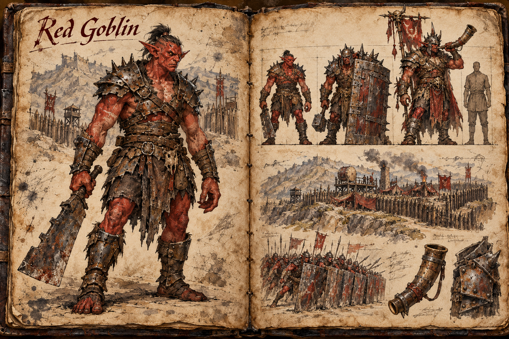
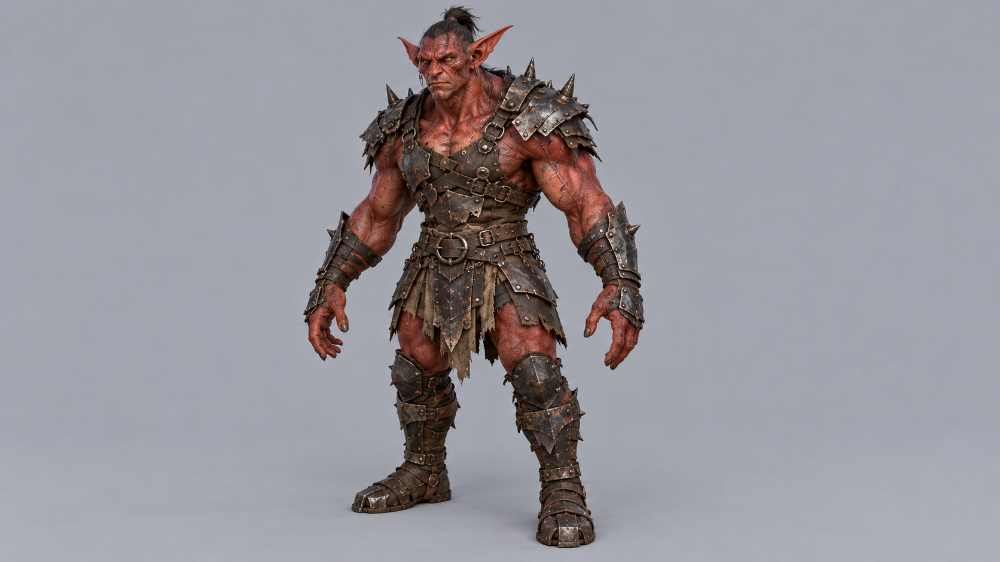

# Red Goblin

Red goblins are the goblin people built for war. Where the [Green Goblin](Green-goblin.md) steals and runs, a red goblin stands its ground in scrap armour as tall and heavy as a human soldier and settles every question with a blade. Their colonies are far fewer than green bands but vastly larger, a hundred to two hundred strong, and each one is a fortified war-camp that exists to raid. A red colony on the move is a war-host, the regional power that [Setting and Lore](../Setting-and-lore.md) and [Guilds and Factions](../Guilds-and-factions.md) describe holding frontier ground against the realms, and it is the threat that turns a quiet stretch of farmland into a front line.

## Appearance and Visual Design

A red goblin is a biped with two arms and two legs, standing between 1,75 and 1,85 metres tall and weighing between 85 and 110 kilograms, the size of a heavily built human. The goblin frame is still there in the long arms, the large hands, the oversized pointed ears and the narrow jaw, but on a red goblin it is packed with muscle: a thick neck, a deep chest, heavy shoulders and forearms roped from swinging iron. It stands upright with a slight forward lean, walks with a heavy, flat-footed stride, and charges in a straight line rather than scrambling or climbing. Nothing about its movement is built for stealth.

The skin runs from brick red to a dark rust, deepest across the back, shoulders and scalp and paler on the chest and the insides of the arms, and it is crossed with pale scar lines that red goblins wear with pride. Eyes are small, deep-set and yellow. Hair, where it grows, is coarse black and worn in a single topknot or shaved.

Their armour is scrap made into a uniform. Plates beaten out of stolen pots, cart fittings, broken blades and battlefield helmets are riveted onto leather in overlapping, jagged layers, blackened in the forge fire and spiked at the shoulders and knuckles. Helmets are heavy and crude, often with a face plate cut into a snarl, and no two suits are alike even though a colony in formation reads as a single dark mass of iron. Weapons are heavy and close-range: cleavers, notched swords, axes, mauls and spiked clubs. Red goblins scorn the bow, and the few missiles they use are thrown just before the lines meet.

## The Colony

Three kinds of red goblin make up a colony, told apart by build and kit. The Grunt is the colony's bulk, armoured in mismatched scrap and armed with whatever blade or club it has earned. The Ironback is larger still, a line-breaker carrying a tower shield of riveted plate taller than its own chest and a short, brutal hammer; Ironbacks lead every assault in a wall of iron, shoulder through barricades and doorways, and carry the rams in a siege. The Warboss rules the camp. It stands close to 2 metres tall, wears the best armour the colony has taken, often pieced together from a fallen knight's harness, and carries trophies from its rivals and its raids. It holds the colony by strength alone and must keep proving it.

A colony lives in a war-camp: a palisade of sharpened logs on defensible high ground, a ring of hide tents and lean-tos around open fighting pits, drum platforms on the walls, and a scrap forge at the centre whose smoke can be seen for kilometres. Red goblins are smiths by necessity. Every suit of armour and every blade is forged in camp from metal they have taken, so the colony's hunger for iron drives its raids as much as its hunger for war. They strike mining camps, ore caravans and smithies, and they pick over old battlefields for broken arms and armour. A taken war-camp is correspondingly rich in salvage: scrap iron, half-forged plates, crude weapons, and whatever stolen stock has not yet gone into the fire.

Red colonies do not tolerate weaker goblins nearby; they put them to work. Green bands within reach of a war-camp are pressed into service as scouts and trappers, filling the roles the red goblins disdain: watching the roads, laying snares on the approaches, and throwing fire pots from behind the iron line. The greens serve out of fear and despise their masters for it, which matters when a fight turns.

## Behaviour and Encounter

Red goblins never sneak, and a player always hears them before seeing them. War drums beat on the march and from the camp walls, and horns answer across the hills, so a settlement on the edge of red goblin country learns to read the sound: a slow, steady beat for a column on the move, a quickening one as it closes, and a single long horn blast for the charge. That warning is the player's most important tool, because it buys the time to close gates, man walls and call for help.

In open battle they come straight on. The Ironbacks lock shields at the front and push, Grunts flood around the flanks once the line is engaged, and the Warboss fights wherever the press is thickest. They do not break the way green bands do. A red colony fights on through losses that would scatter any green band, and a player who waits for it to lose its nerve will wait too long. Its weakness is at the top. Killing the Warboss does not rout the colony but ends its common purpose: the largest survivors turn on one another to decide who leads next, the line dissolves into brawls, and the pressed green auxiliaries are the first to desert, often looting the camp on their way out. The charge horn is the Warboss's own, and when it sounds a second time in battle the Warboss is wading in, its trophy standard pushing forward through the ranks; a group that can cut through to it in that moment can end a battle at a stroke.

The Ironback's wall is the other thing to answer. Shields stop arrows and spells cast from the front, so archers and casters do their work on the flanks and from above, and a well-placed obstacle, a ditch, or a narrow gate forces the wall to break formation before it reaches the defenders.

## Role in the World

Red goblins are a mid- to high-tier threat, and they are the goblins of [Raids](../Raids.md). A war-host besieges settlements rather than ambushing travellers, bringing rams, scaling ladders and the weight of a hundred armoured bodies against palisades, gates and the walls of player bases built under the [Building System](../Building-system.md). Their camps sit on rough, defensible ground: the foothills of the [Mountain Range](../Biomes/Mountain-range.md) and the canyons of the [Mesa](../Biomes/Mesa.md), from which they raid out across the edges of the [Plains](../Biomes/Plains.md) toward frontier settlements and the outermost farmland of the realms. Breaking a war-camp is a group undertaking and a regional event, one that can change who holds a stretch of frontier, and the settlements it threatened remember who came to help, as the [Reputation System](../Reputation-system.md) records.

## Story Hook

A frontier hamlet on the edge of the plains has heard drums in the foothills every night for a week, each night a little closer, while its trading post keeps doing brisk business with a pedlar who buys up every broken tool and scrap of iron in the district. The pedlar pays well, and nobody asks where the metal goes until a scout finds the same cart, emptied, at the gate of a red goblin war-camp whose forge has not gone cold in days. The hamlet's elders are frightened and divided. A player can expose the pedlar and cut off the colony's iron, rally the hamlet and its neighbours to stand behind their palisade when the war-host comes, or strike the camp first while its warriors are still waiting on their armour.

See also: [Creatures index](../Creatures.md), the [Green Goblin](Green-goblin.md) bands it presses into service, the [Golden Goblin](Golden-goblin.md) that trails its war-hosts, the [Mountain Range](../Biomes/Mountain-range.md), [Mesa](../Biomes/Mesa.md) and [Plains](../Biomes/Plains.md) it raids from and across, and [Raids](../Raids.md).

## Concept Drawing

## Inspiration

The red goblin draws on the orcs of [J. R. R. Tolkien's Middle-earth](https://tolkiengateway.net/wiki/Orcs), and particularly the [Uruk-hai](https://tolkiengateway.net/wiki/Uruk-hai) as Peter Jackson's *The Lord of the Rings* films presented them: human-sized, muscular warriors in jagged, forge-blackened scrap armour, fighting as a disciplined mass behind shields and marching to drums. What differs is the master. Red goblins serve no dark lord and were made by no one; they are a people of the wild, and their war is their own, driven by iron, plunder and the standing of each Warboss rather than by a will greater than theirs.

## Draft

<!-- Raw notes land here. Add new content in any form; an AI assistant reworks it into the body above as finished prose, then clears what it has integrated. -->
