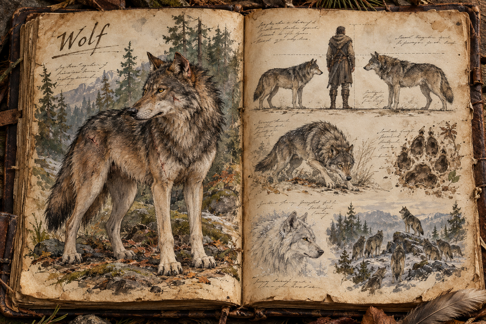
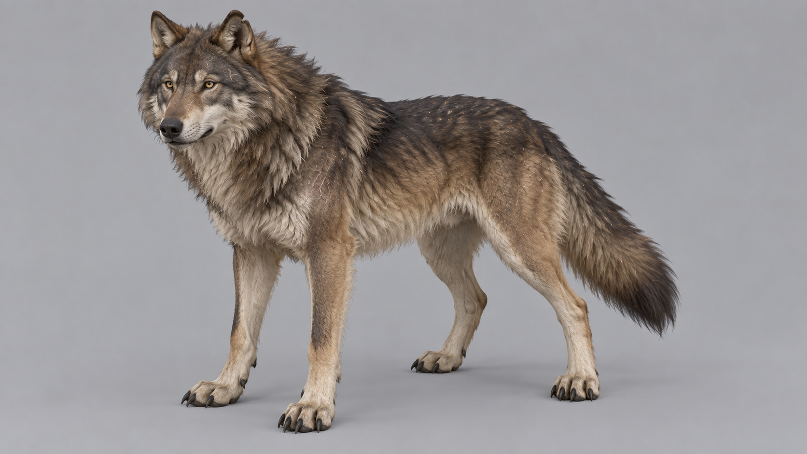

# Wolf

Wolves are the grounded, familiar early-game predator, the threat a player is most likely to meet on the first walk into the wild. They are deliberately recognisable, but they do not behave like the lone, suicidal wolves of most games. Here they are true pack hunters, packs of four to seven that work a target together, and an encounter with them is a lesson in how the wilderness fights back as a group rather than as a single health bar.

## Appearance and Visual Design

A wolf is a four-legged canine that stands 0,85 metres at the shoulder, runs about 1,60 metres from nose to rump with a further 0,50 metres of tail, and weighs between 45 and 60 kilograms. The pack leader is the largest animal in the pack, about 15 percent bigger than the rest. The frame is lean, long-legged and built for endurance: a deep chest, a narrow waist, a heavy ruff around the neck and shoulders, and broad paws that leave readable tracks in mud, snow and leaf litter.

Coats run grey, brown and charcoal, paler on the belly and the insides of the legs, with a darker saddle along the back. In winter every wolf grows a thick white-grey coat, so the same pack looks different from one season to the next (see [Weather, Time and Seasons](../Weather-time-and-seasons.md)). Scars, torn ears, patches of missing fur and old bite marks make each animal look like a survivor of its own hierarchy. At night the eyes catch torchlight in brief yellow flashes, a rhythm of points appearing and vanishing around the player.

## Movement and Posture

A wolf trots at 4 metres a second with its head level and its tail trailing, covering ground without effort, and breaks into a sprint of 9,5 metres a second that it holds for about eight seconds before it tires. Against a player who jogs at 3,5 metres a second and sprints at 6,5, that outruns a running player over short distances, but it is a threat to a sprinter only for as long as the wind lasts. A player who jogs away from a stalking pack does not wear it out: the wolves close at the trot and spend short bursts of sprint, and they catch a jogger in the open. A player who sprints draws the same wolves into long sprints, and at any moment about a third of them are winded: the chase wears the pack out as surely as it wears out the runner.

A winded wolf drops to a recovering gait. One that is calm walks at 1,5 metres a second, while one under stress trots at a slower recovery pace. A wolf is under stress when another wolf holding a lunge or a feint is within a few metres of it, when another is mauling the target nearby, when it holds such an order itself, or when the pack fighting beside it is three wolves or fewer. In a large pack that sorts the circle by its place in the fight, so the winded wolves at the back walk to recover while the winded wolves at the front keep trotting, and a pack that has lost its prey lets every wolf walk. The pack leader holds the highest ground, keeps its head lower when stalking and fixes the player with a steadier gaze, while the others move at the edges of vision, crossing behind trunks and rocks. The pack sells its coordination before its aggression: bodies passing behind cover, a slow closing of the circle, then the attack.

A wolf sees to 30 metres, within 110 degrees either side of where its head points, and hears to 50 metres. Its head turns toward what it watches by at most 80 degrees, and only when it has something to watch, so a wolf that is merely grazing or roaming is blind across a 140-degree arc straight behind it. A player who walks up on a pack from behind, or who stands still, can stay unnoticed inside that arc until a wolf turns, which takes about three seconds as the pack wanders on; a standing player makes no sound at all, where a sprinting player is heard across the whole of the wolf's range, as [Noise](../Movement.md#noise) sets out.
## Pack Tactics

Wolves circle and flank. A pack watches its prey from 12 metres, then closes its circle from 10 metres to 4,5 over about six seconds, each wolf taking cover behind trunks and rocks near its place in the ring and pacing about it rather than standing. They work toward an isolated target, the straggler of a group or the traveller who has stepped away from a fire. Their ordinary prey is the [Red Deer](Red-deer.md), which outsprints a wolf but tires first, so a pack runs a herd until one deer is winded and then switches to it, and leaves a cornered stag with its antlers lowered alone. A wolf the player walks straight at gives ground sideways, swinging round toward the player's back, so a pack that is charged splits and flows around the player instead of retreating in a line.

Once the circle has closed the pack attacks in waves, one every 1,5 to 3,5 seconds. In each wave the one or two wolves the player is looking at dash in, snap and peel away, and while the player is fixed on them a third wolf gives the [tell](../Glossary.md) and lunges from the side. When six or more wolves are fighting, a second lunger follows a second later from the opposite flank. One wolf always holds back, so a wave never empties the circle.

The killing move is the lunge, which knocks the victim down so that the rest of the pack closes in. Before it the tail drops and the shoulders roll low, and that tell is the player's cue to turn and brace. It is never given from the blind spot behind a first-person camera, where nobody could see it: the lunge comes from the corner of the eye, from a wolf between about 50 and 110 degrees off the direction the player is looking, and a wolf outside that band lunges only when none is inside it. Turning to face the wolf is not enough to brace: the player braces only with a guard raised toward the attacker, and a guard still swinging round to a wolf that came from the flank is too late. A braced lunge is caught at a stamina cost in proportion to its force, and a guard that cannot pay breaks, so a tired player is thrown as surely as one who never raised a guard. The pack lunges from the flank by design, which leaves turning to the tell as the player's part; how a guard catches a blow is set out in [Actions](../Actions.md#creatures) and [Melee Combat](../Melee-combat.md#when-a-strike-lands). The lunges land on the arms, which makes what a player wears there part of the fight (see [Armour](../Armour.md#coverage-and-gaps)).

A wolf that has just leapt past its prey lands with the player under a metre from it and loses sight of them until it turns. That is the counter window: a player who strikes the landing wolf, or steps out of its line, is fighting an animal that cannot see them for a moment, though the pack remembers a threat for about eight seconds, so the window ends no fight on its own.

A howl calls only wolves that have no leader of their own, the remnant of a pack whose leader fell or a lone wolf, and they fight as followers of the pack that howled. A pack with a leader ignores another pack's howl and will not hunt prey that another pack is already hunting, so a skirmish at the edge of a territory can grow into a full pack if it is not ended quickly, but never into two.

Fighting them rewards positioning over raw damage. Putting your back to a tree or a rock face removes the flank, and wounding the leader breaks the pack's nerve, though only a grievous wound does it, not a scratch. The leader fixes the player with its gaze from about 1,3 times the circle's radius, nearly 6 metres back when the circle is at its tightest, so reaching it means pushing through the wolves in between.

Fire slows the hunt without ending it. A torch throws light 6 metres around the player and a campfire 8, and wolves feel it for a further 2 metres beyond. A wolf standing in that zone grows afraid and backs out of the light, and it will not attack until it has calmed; enough fire sends it running. The circle paces at the edge of the light and attacks far less often, and a player who steps out of the light is fair game again.

A pack abandons a fight after losing about half its number, or when its leader's nerve breaks, or when it faces a group larger than its own, and it withdraws to about 30 metres from any player it sees, keeping to the trees and holding that distance for a minute after it has fled. It harries a weakened traveller as readily as it avoids a strong party. A traveller who has sprinted themselves winded is a weakened one: the pack hears the ragged breathing from across its range and closes, exactly as it closes on the [red deer](Red-deer.md) that falls behind its herd, as [Movement](../Movement.md#creatures-and-mounts) describes. A player who treats a pack as several separate fights tends to lose; one who treats it as a single problem with several moving parts comes out ahead. They den in temperate woodland and range its edges, which makes the [Forest](../Biomes/Forest.md) the place most players first learn what a pack can do.

## Drops and Taming

A dead wolf yields hide, meat, bone and fangs, the staple materials of early clothing, food and crude weapons. Wolf pups found at a den can be raised through [Parental Bonding](../Taming-and-control.md), the strongest of the taming methods, which turns a dangerous hunter into a companion or a [war mount](../Creature-riding.md#kinds-of-mount) and gives the den a reason to be approached with something other than a spear.

## Story Hook

On the edge of a northern encampment, an old hunter kept a carved wolf-bone talisman that the villagers believed kept the pack at bay. When he vanished, the talisman was found cracked beside a line of pawprints leading into the pines. The prints end at a den, where the pack's pups lie in the roots beside the hunter's pack and a few scraps of his gear. A player who follows the trail has to decide what to do with a litter the pack will soon come back to: clear the den before the adults return, carry the pups away to raise them, or leave quietly and let the village keep its legend.

See also: [Creatures index](../Creatures.md) and the [Forest](../Biomes/Forest.md) it hunts in.

## Concept Drawing

## Draft

<!-- Raw notes land here. Add new content in any form; an AI assistant reworks it into the body above as finished prose, then clears what it has integrated. -->
